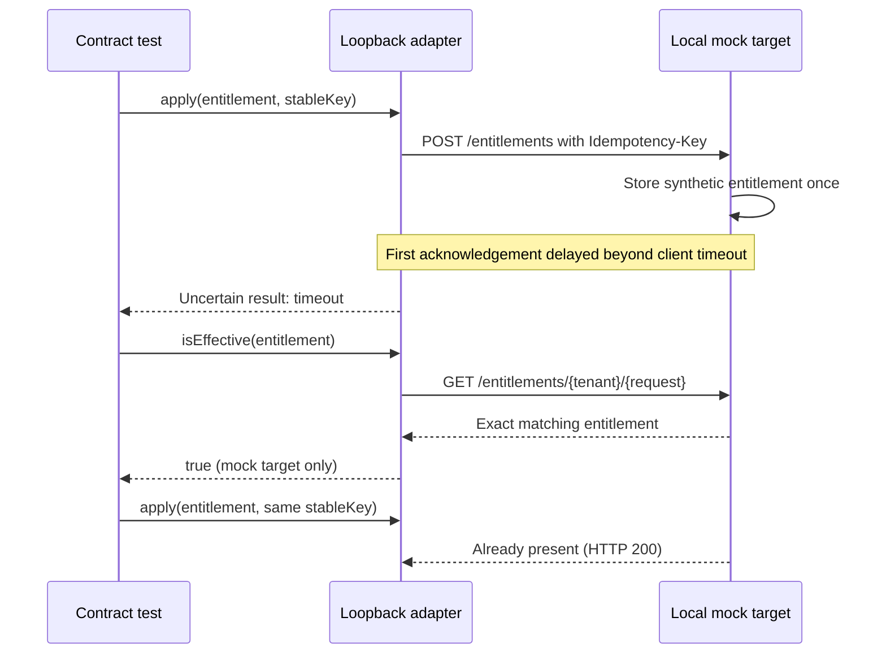

# Milestone 04E-2 — Loopback HTTP mock provisioning transport

**Status:** Draft pending local and GitHub CI. This increment does not call a real identity system and **does not** mark external provisioning complete.

## Why

Milestone 04E-1 defined an adapter contract and durable write-ahead attempt evidence but did not exercise an HTTP boundary. 04E-2 tests the distinction between HTTP acknowledgment, an uncertain outcome after a timeout, and an independently observed effective entitlement.

## Implementation

- `LoopbackHttpProvisioningTargetAdapter` implements `ProvisioningTargetAdapter` without a Spring bean registration. Its constructor accepts only **`http://127.0.0.1:<ephemeral-port>`** with no path, query, credentials or fragment. External targets and redirects are rejected.
- The adapter uses the Java HTTP client, explicit 100ms–5s request/connect timeouts, no redirects, a stable idempotency key supplied by 04E-1, and no automated retries.
- `POST /entitlements` returns 201 (new) or 200 (already present). An HTTP response is **not** treated as evidence of effective entitlement.
- `GET /entitlements/{tenant}/{request}` checks readback of the full tenant, request, subject, application and role tuple. 404 means absent; other error responses fail closed.
- The test-only `HttpServer` emulates persistent acceptance before a lost/delayed acknowledgement, duplicate idempotent requests, mismatched entitlement readback, and redirect rejection. The fake target exists only inside the unit tests.
- **No Flyway migration or JDBC call in this increment.** The existing V8 journal remains available for a future orchestrator; it is *not* yet wired to network execution.

## Recovery sequence (contract test only)

## Acceptance checks

Run `mvn -B --no-transfer-progress clean verify` using local JDK HttpServer + disposable PostgreSQL Testcontainers. Tests verify:
- Idempotent repeated POSTs produce one mock-target entitlement.
- GET verifies the full tuple, not only status 200.
- Lost acknowledgement does not imply failure or success; readback reconciles it, and retry uses the same stable key.
- Redirects, non-loopback URLs, insecure unbounded timeout settings and mismatched role fail closed.
- Existing audit, approval, journal and lease tests remain unchanged and passing.

## Remaining work

**04E-3** must add orchestration guarded by the V8 journal, a separately controlled state machine for external verification, durable outcome evidence, attempts/reconciliation and observability. Do not reuse 04D simulation `SUCCEEDED` for real external provisioning. Real target integration also requires OAuth2 client credentials, scoped application identity, mTLS or equivalent transport controls, secret rotation, threat modeling, and least-privilege access.

The 03D real signed-token Keycloak approval acceptance remains pending.
