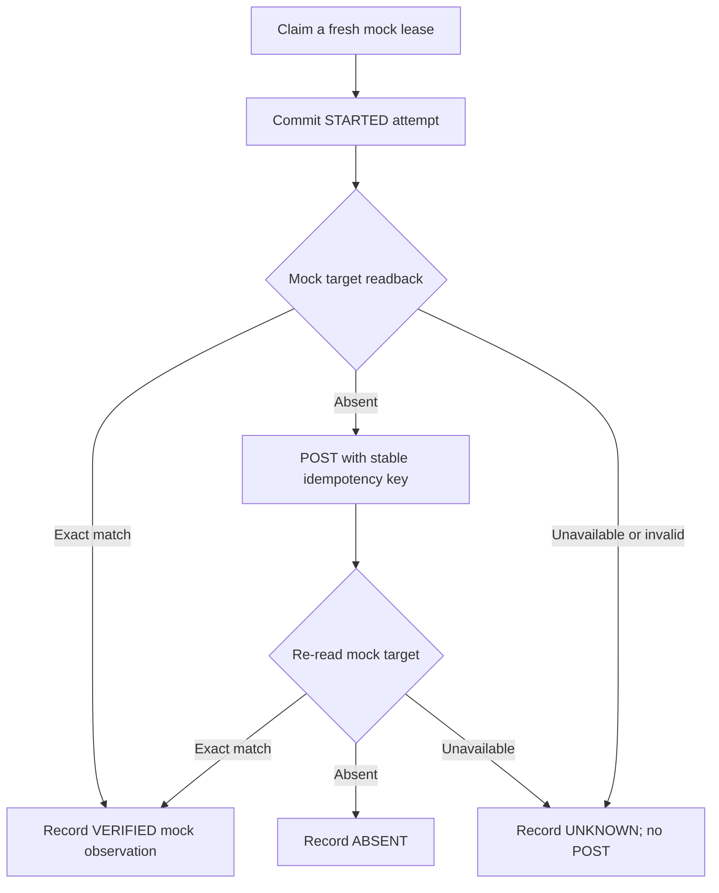

# Milestone 04E-4 — Read-before-write recovery for uncertain mock outcomes

**Status:** Draft; local and GitHub CI verification pending. No real target connection, no production entitlement success.

## Failure scenario

A worker can commit a `STARTED` record, POST to a remote target, and crash before receiving or storing acknowledgement and readback evidence. Retrying a POST unconditionally after a lease expires risks unnecessary duplicate operations. Stable idempotency keys help, but independent readback is still the most reliable first question: **Does the target already hold the exact entitlement?**

## Change and design decision

`MockProvisioningOrchestrator.execute(lease)` now follows:

- The V8 `STARTED` journal still commits before any HTTP traffic.
- An exact readback match means no POST is necessary.
- If readback is absent, POST uses the stable tenant/request idempotency key; acknowledgement is not treated as proof of effective access.
- If preflight readback fails or times out, the attempt records `UNKNOWN` **without writing to the mock target**.
- After a POST, readback determines `VERIFIED`, `ABSENT` or `UNKNOWN`.
- V9 observations continue to require a currently valid lease token and matching STARTED record. The work item remains `LEASED` (never `SUCCEEDED` due to mock evidence).

## Validation

`mvn -B --no-transfer-progress clean verify`, with disposable PostgreSQL containers and localhost mock HTTP tests. New integration scenarios:

1. A crashed first worker left a durable STARTED attempt and the mock target holds the entitlement. After lease recovery, the replacement records VERIFIED **without another POST**.
2. Preflight HTTP readback returns 503: the orchestrator records UNKNOWN with **zero target writes**.

Existing tests for normal apply, unavailable target and lease fencing must remain passing.

## Limitations and future policy

- This is a single best-effort reconciliation step, **not a continuous recovery engine**. There is no autonomous scheduler, retry supervisor or admin release.
- A verified mock observation is *not* real effective access. No production access is granted or recorded as `SUCCEEDED`.
- Reconciliation remains subject to real target consistency models, propagation delays, authorization and token expiry; future adapters require authenticated transport, distinct target role scopes and negative testing.
- A single V9 observation per attempt cannot describe late-changing target state. An append-only observation history and an explicit reconciliation command policy are future work.
- `ProvisioningLeaseService` still bounds attempts at three and quarantines exhausted work. Quarantine requires operational review.
- The live 03D signed-token Keycloak approval acceptance test remains outstanding.

## Interview explanation

**Why read before write?** To handle the uncertain-outcome window after a successful remote write with a lost acknowledgement, reducing duplicate operations. **Why still use idempotency keys?** Readback can be stale or absent during propagation; a stable key remains essential if a POST is necessary. **Why not mark SUCCEEDED?** This is an untrusted, local mock-target observation—not a verified grant in a production target.
