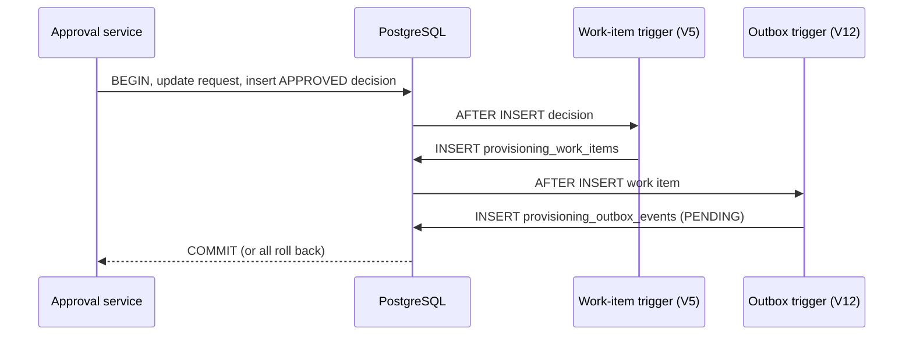

# Milestone 04G — Transactional outbox foundation

## Why
An approval, work item and event must commit atomically. Publishing to a broker
inside the JDBC transaction would risk a dual-write failure.

## What is implemented (04G-1)
- Flyway V12 adds tenant-scoped `provisioning_outbox_events` with stable UUID event IDs,
  JSONB schema version 1, a uniqueness constraint on provisioning intent and `PENDING` state.
- An AFTER INSERT trigger on `provisioning_work_items` writes the event in the same
  PostgreSQL transaction already used for approval, audit and provisioning intent.
- The payload contains only tenant ID, request ID, event type and schema version;
  no passwords, tokens, personal attributes or broker-specific metadata.
- PostgreSQL integration tests validate approval, rejection and rollback.
- No broker, publisher or scheduled worker is introduced in this increment.

## Deliberate boundaries
- No V12 backfill of historical approved work items. A migration must not silently
  replay old entitlements; a separate operator-approved backfill design is required.
- The outbox table has no FK to the business work item: events remain durable even
  if the business record is later retained or removed by independently governed
  policies. Tenant/request correlation comes from the trigger, constraints and tests.
- Event UUID uniqueness prevents duplicate event identity; tenant/request/type
  uniqueness prevents duplicate intent events. Consumers still need idempotency.
- `PENDING` is the only status for now; later migrations will introduce lease and
  delivery states. Do not mark events delivered from this code.
- The current educational capstone does NOT provision real external identities.

## How to validate
From the repository root:

```bash
mvn -B --no-transfer-progress clean verify
python3 -m unittest discover -s ops/keycloak -p 'test_*.py'
git diff --check
```

Record actual test results, JDK version and commit SHA after executing commands.
Do not claim unexecuted tests succeeded.

## Sequence


## Interview questions
**Why not publish directly?** Database transactions cannot atomically commit
broker delivery. Durable outbox intent separates local atomicity from eventual
external delivery.

**Does V12 give exactly-once delivery?** No. It creates an event once per
provisioning intent locally, but a future relay can publish it more than once
if it crashes after publish before acknowledging delivery.

**What happens at 10x traffic?** An eventual relay needs bounded batches,
`FOR UPDATE SKIP LOCKED`, lease fencing, retry/backoff, backlog and age metrics,
and consumer-side deduplication.

**Why no automatic historical backfill?** Historical requests could already
have been processed; unreviewed event replay could cause duplicate side effects.
