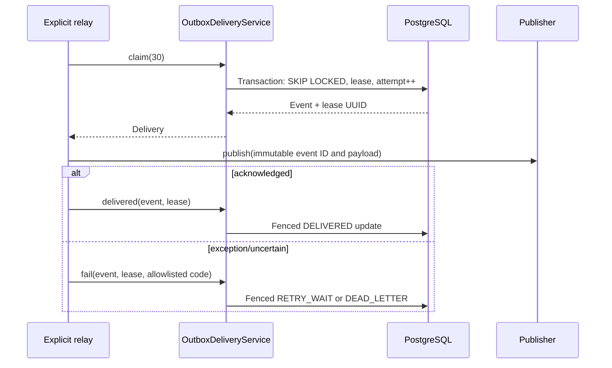

# Milestone 04G-2 — Lease-fenced outbox delivery

## What and why
V12 provides atomic event creation, not external delivery. V13 adds durable
leased claims, bounded retries and terminal dead-letter handling, without
coupling a database transaction to a remote publisher.

## Implementation
- V13 extends the existing event table; V12 remains immutable.
- `OutboxDeliveryService` uses a PostgreSQL `SKIP LOCKED` claim and UUID
  lease-token fencing. Lease expiration permits re-delivery, not exactly-once delivery.
- Maximum five attempts; failed publishes use a bounded exponential delay.
- `OutboxEventPublisher` is injected into an explicitly constructed `OutboxRelay`.
  No scheduler, broker or real target adapter is enabled.
- A callback that returns normally means the publisher acknowledged success;
  an exception is classified as unavailable. It can still have succeeded remotely.
- The same immutable event ID is presented on every retry, allowing downstream
  idempotency to be built as a separate increment.
- Last-error codes are allowlisted. Exception details and secrets are not persisted.

## Sequence

## Invariants and tests
- Two concurrent workers cannot claim the same eligible event.
- Expired leases cannot acknowledge, and recovery changes the lease token.
- Five failed attempts end at DEAD_LETTER; no unbounded retries.
- Event identity is unchanged by retries; payload remains versioned.
- No SQL transaction spans an external `publish` invocation.
- PostgreSQL integration tests are isolated using Testcontainers.

## Limitations / next slice
This is a deliberately **manually invoked** relay with a local publisher contract.
There is no broker, persistent consumer inbox, scheduling, operator dead-letter
release, or production delivery guarantee. Consumer deduplication and safe
operational activation must be designed before any real message transport.

## Interview questions
**Crash after publish but before acknowledgement?** The event lease expires and
is published again. Consumers must handle duplicate event IDs.

**Why SKIP LOCKED?** Parallel claimers avoid waiting on the same row while
preserving exclusive ownership of an active lease.

**Why is this not exactly-once?** The local DB cannot atomically commit an
external publication. At-least-once delivery plus consumer idempotency is the
recoverable design.
