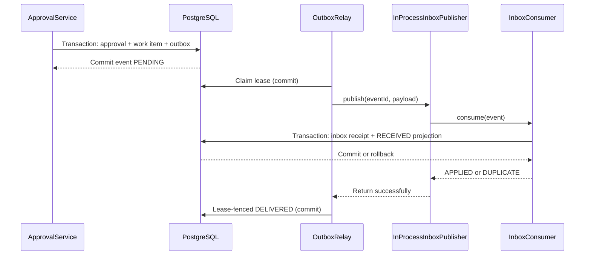

# Milestone 04G-4 — End-to-end local event flow

## Why
Individual outbox and inbox integration tests do not demonstrate the entire approval-to-consumer path. This increment connects the components without introducing a broker, scheduler, network listener or external provisioning.

## What
- `InProcessInboxPublisher` adapts the existing `OutboxEventPublisher` interface to the existing `ProvisioningInboxConsumer`.
- It is deliberately **not** a Spring bean: it is constructed explicitly by an internal test harness; it must not accidentally enable production delivery.
- No Flyway V15 is necessary; V12–V14 already supply the event, lease, inbox and projection state.
- Three PostgreSQL Testcontainers tests exercise real approval → work item → outbox → relay → inbox → projection, including lost acknowledgments and temporary consumer unavailability.

## Transaction and failure boundaries


**Lost acknowledgment:** inbox transaction commits; publisher then throws; relay records RETRY_WAIT; eventual replay returns DUPLICATE and the receipt/projection count stays one. This is **at-least-once delivery with idempotent local effects**, not exactly-once messaging.

**Consumer unavailable:** an error before inbox consumption leaves no receipt and no projection; the event remains retryable and is not marked DELIVERED.

## Security and scope
The in-process adapter trusts only an event passed by the internal relay. There is no externally exposed message listener or target provisioning. A real broker integration requires authenticated event provenance, tenant authorization, schema/contract validation, poison-event handling, retention, observability and a controlled rollout.

## Run verification
```bash
mvn -B --no-transfer-progress -Dit.test=OutboxInboxEndToEndIT -DfailIfNoTests=false verify
mvn -B --no-transfer-progress clean verify
python3 -m unittest discover -s ops/keycloak -p 'test_*.py'
```
Record *observed* test counts, Java version and commit SHA. No tests are claimed to have passed until executed.

## Interview questions
1. Why does inbox commit happen before outbox DELIVERED?
2. What happens if publication succeeds but its acknowledgment fails?
3. Why does a same-process call not demonstrate broker durability or authentication?
4. What evidence distinguishes RECEIVED from an effective entitlement?
