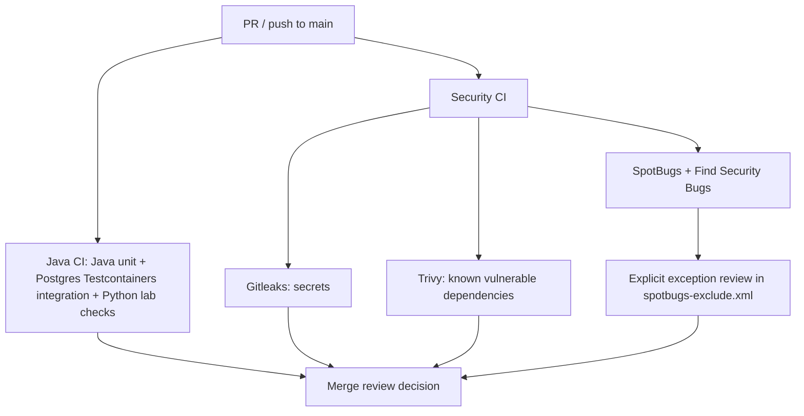

# Milestone 05A — Security baseline closeout and evidence register

**Project:** Enterprise Identity & Access Platform (educational IAM governance modular monolith)  
**Milestone scope:** 05A-1 through 05A-4  
**Baseline main commit:** `5822c1f` (squash merge of PR #41, 2026-11-13)  
**Result:** Implemented and merged into `main`; subsequent changes require their own review and CI.

## 1. Executive summary

The platform now has three distinct automated security disciplines—secret detection (Gitleaks), dependency vulnerability review (Trivy), and Java bytecode SAST (SpotBugs + Find Security Bugs)—plus adversarial authorization tests and PostgreSQL-backed HTTP no-mutation regression tests. All four PR #41 GitHub checks were reported successful prior to merge.

**Evidence statement, not certification:** Passing the security pipeline establishes that these particular checks passed on the tested commit. It does not establish complete vulnerability coverage, a production penetration test, a compliant deployment, or real external IdP interoperability.

## 2. Delivery and traceability

| Increment | Pull request | Merged result / scope |
| --- | --- | --- |
| 05A-1 — CI security baseline | [#38](https://github.com/asambataiden/enterprise-identity-access-platform/pull/38) | Gitleaks and Trivy workflows; baseline Java/Python checks |
| 05A-2 — Java SAST | [#39](https://github.com/asambataiden/enterprise-identity-access-platform/pull/39) | SpotBugs/Find Security Bugs; explicit identity claim guards; lease count invariant; documented exclusions |
| 05A-3 — Adversarial identity boundary | [#40](https://github.com/asambataiden/enterprise-identity-access-platform/pull/40) | 21 resolver-level malformed identity scenarios (7 each for request, decision and quarantine) |
| 05A-4 — HTTP security regression | [#41](https://github.com/asambataiden/enterprise-identity-access-platform/pull/41) | Six malformed tenant HTTP cases on approval and quarantine paths; verify no unauthorized business state mutation |

Merged baseline `5822c1f`. CI evidence: all four PR #41 checks passed (Java CI, Gitleaks, Trivy, SpotBugs + Find Security Bugs) before squash-merge. The successful results are tied to the PR's tested head, not to an independently performed pentest or an asserted post-merge deployment.

## 3. Implemented architecture



**IAM authorization path:** JWT signature/issuer/audience validation in decoder-level tests; the Spring Security route checks scopes; a resolver validates non-null issuer and subject and a parseable tenant UUID; a PostgreSQL query binds tenant, issuer, subject, ACTIVE employee and an explicit permission; only then may a business operation proceed. Test doubles used by MockMvc **do not** independently demonstrate live JWT cryptographic validation.

## 4. Evidence matrix

| Security invariant | Test / mechanism | Meaning and limits |
| --- | --- | --- |
| Unknown signing key, wrong issuer/audience, expired JWT rejected | `SignedJwtTrustValidationTest` | Offline decoder test with test-only RSA keys; not a live Keycloak end-to-end test |
| Missing or malformed actor identity fails with 403 before JDBC | `ActorResolverInvalidClaimsTest` | 21 negative checks using Mockito; tests three separate resolvers |
| Missing/blank/bad tenant on approval denied and no decision recorded | `ApprovalDecisionHttpIT` | MockMvc + PostgreSQL Testcontainers; database remains PENDING with zero decision rows |
| Missing/blank/bad tenant on quarantine detail denied | `QuarantineInspectionHttpIT` | MockMvc + PostgreSQL Testcontainers; existing QUARANTINED state retained, no review record created |
| Cross-tenant decisions, missing local permission, self-approval | `ApprovalDecisionHttpIT` | Existing negative integration scenarios; check both HTTP status and no-write invariants |
| Header tenant spoofing and cross-tenant employee targeting | `AccessRequestPersistenceIT` | Existing negative HTTP scenarios with no new access-request row |
| Prevent leak of secrets, vulnerable dependencies and Java SAST findings | `.github/workflows/security-ci.yml` | Scanner configuration and hosted job outcome; tools are complementary, not comprehensive |

## 5. Static-analysis exception governance

The checked-in `config/spotbugs-exclude.xml` contains **16 explicit Match elements**, not a global disable:

- 14 class+field-specific `EI_EXPOSE_REP2` cases for framework-managed `JdbcTemplate` injection. Acceptance rationale: dependency retention is intentional and does not by itself expose mutable user-owned state. **Check the actual matched findings and revisit after major refactors**.
- 1 `SPRING_CSRF_PROTECTION_DISABLED` case in `BootstrapSecurityConfiguration`, conditional on a stateless, bearer-only API with no browser cookie/session authentication. Any change to browser credential behavior invalidates the justification.
- 1 `CT_CONSTRUCTOR_THROW` case in `ProvisioningInboxConsumer`. Revisit constructor validation and potential finalization/inheritance behavior before assuming suppression remains appropriate.

**Audit limitation:** The presence of a class/field exclusion does not alone prove that it matched exactly one runtime finding or will remain narrow under plugin upgrades. Preserve and periodically inspect both **unfiltered** and **filtered** SpotBugs reports, and remove stale exceptions. Never treat exclusions as proof of safety.

## 6. Open risks and technical debt

| Priority | Remaining risk | Next action / acceptance criterion |
| --- | --- | --- |
| High | SpotBugs previously reported missing analyzed classes/methods (including lambda/invokedynamic names) | Capture full analyzer warnings and determine whether classpath resolution, bytecode support or plugin compatibility reduces coverage; no unsupported coverage claims |
| High | Scanner exceptions can hide newly relevant issues after code/security model changes | Establish exception owner, rationale, review date and unfiltered report comparison; CI should fail on new non-excluded findings |
| High | No demonstrated live Keycloak-to-API HTTP interoperability in this milestone | Add signed-token end-to-end smoke tests for bad issuer, audience, signature and tenant membership in controlled environment |
| Medium | GitHub Actions use version tags rather than immutable action SHA pins | Inventory, approve and pin action SHAs with a documented update cadence |
| Medium | No captured audit-quality security artifact manifest for each CI run | Store nonsecret results (report digests, commit SHA, action versions, test totals) with access/retention policy |
| Medium | PostgreSQL/Testcontainers SSL startup fault has previously occurred | Investigate root cause if recurrent, with test environment logs; do not disable TLS checks in production settings |
| Medium | Unit and MockMvc tests do not demonstrate timing-safe access denial or full privilege-revocation concurrency | Add targeted cross-tenant isolation and permission-revocation race tests |
| Medium | No external assessment or production deployment threat-model verification | Schedule targeted threat-model review and authorized security assessment before any production use |

## 7. Reproducible developer validation

```bash
git switch main
git pull --ff-only origin main
python3 -m unittest discover -s ops/keycloak -p 'test_*.py'
mvn -B --no-transfer-progress clean verify
mvn -B --no-transfer-progress -DskipTests package spotbugs:check
git status --short --branch
```

Interpret successful verification with the **tested commit SHA and environment**. `mvn -DskipTests package` still compiles tests: a Java test compilation failure can prevent both SAST and Trivy jobs from reaching the scanner stage. Do not report those cases as vulnerability findings.

## 8. Use cases and interview learning

**UC-01: Tenant spoofing via HTTP header.** A client sends a valid token for tenant B and a request header naming tenant A. Authorization resolves from verified JWT identity + local DB membership, not the header, so the spoofed access fails.

**UC-02: Signed JWT without application authorization.** Valid JWT, expected scope, but no active employee/permission record. Route scope is necessary but insufficient; local IAM checks deny.

**UC-03: Malformed tenant claim.** Missing, blank or non-UUID tenant cannot default to a tenant; denial occurs before business mutation.

**UC-04: Quarantined provisioning item.** Failed provisioning is read-only under a dedicated review permission. Incorrect identity may not inspect state; denying the request cannot record a review action.

**UC-05: SAST hit in ordinary Spring dependency injection.** Analyst verifies the concrete data flow, checks actual threat, records narrow class/field exception, and tracks the exception through future reviews instead of switching off the rule.

**Interview Q: Why combine SAST, SCA and behavior tests?** They cover different failure classes: program-code patterns, vulnerable software components, and business authorization invariants.

**Interview Q: What is your evidence for no side effects on denial?** Assertions on PostgreSQL records after HTTP denial, not only status-code assertions.

**Interview Q: What remains unproven?** Live production IdP integration, complete classpath/taint coverage, operational threat model and penetration-test results.

## 9. Closeout decision and follow-up

**05A is closed as a merged CI + authorization-regression baseline, not as a comprehensive security assurance certification.** Prefer a dedicated next security-hardening milestone to resolve analyzer completeness, action supply-chain pinning and reproducible security evidence before stacking more scanners. Keep production IAM code, schemas and operational deployments out of this documentation-only closeout PR.
