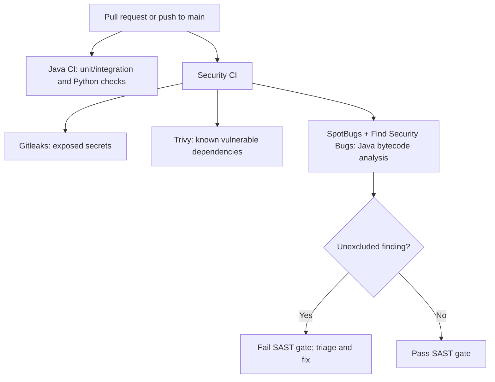

# Milestone 05A-2 — Java SAST: implementation, use cases, and learning

## Purpose and scope
Extend Milestone 05A-1 (Gitleaks secret detection and Trivy dependency scanning) with source-code-oriented static application security testing (SAST) using SpotBugs + Find Security Bugs on Java 25 / Spring Boot 4.1.2. This is an educational modular-monolith IAM implementation; no live entitlement provisioning, database migration, or authentication contract change is part of this increment.

## Design and workflow


## Implementation — what, why, and how
1. **Maven configuration.** Pin `spotbugs-maven-plugin:4.10.5.0` and `findsecbugs-plugin:1.12.0`. Set maximal analysis effort, medium reporting threshold, XML report, and `failOnError=true`. Run `mvn -B --no-transfer-progress -DskipTests package spotbugs:check`. The `package` goal prepares bytecode; the `check` goal fails on unexcluded detected bugs.
2. **JWT actor identity (three resolvers).** Guard against null JWT, missing issuer, blank subject, malformed or missing tenant claim; capture identity fields once. Preserve tenant-scoped employee/permission lookup, and return the existing 403 denial rather than defaulting to another tenant. Scope and database permission checks are cumulative, not alternatives.
3. **Provisioning lease state.** Reject nullable, zero, or above-limit attempt counts before constructing a lease. A thrown exception rolls back the enclosing transactional claim, protecting retry and fencing invariants.
4. **False-positive governance.** `config/spotbugs-exclude.xml` has a narrowly scoped match for each of the 14 pre-existing `jdbc` injected fields, the existing CSRF rule, and the known inbox constructor warning. No global wildcard suppression; newly introduced classes or fields remain subject to analysis.
5. **GitHub Actions.** A separate `java-sast` job runs with read-only token, non-persistent checkout credentials, Temurin 25 and no production secrets. The job is blocking on the repository's PRs and main pushes.

## Threat model and security use cases
| ID | Use case | Threat / invalid input | Required behavior | Evidence |
| --- | --- | --- | --- | --- |
| IAM-SAST-01 | Create access request | JWT missing, subject absent or issuer absent | Deny with 403 before actor lookup; no default identity | Code guard; existing HTTP tests, additional adversarial test desirable |
| IAM-SAST-02 | Approve access request | Tenant claim missing, blank or invalid UUID | Deny with 403, no cross-tenant fallback | Resolver guard; approval integration suite |
| IAM-SAST-03 | Quarantine review | Valid scope but inactive or unprivileged employee | Deny, since token scope alone is not permission | Tenant + employee + permission SQL lookup |
| IAM-SAST-04 | Worker claim | Missing/corrupt lease attempt count | Abort transaction; never return invalid lease | Explicit count validation and transactional boundary |
| IAM-SAST-05 | Auth model migration | Browser cookies/session auth added to API | Reassess CSRF; exception no longer justified | Security configuration decision review |
| IAM-SAST-06 | New Java security bug | SAST finds unexcluded medium/high finding | Fail CI and require review | Java SAST gate |

## SpotBugs baseline and reviewed exceptions
Initial baseline before remediation was 23 findings with zero reported analyzer errors; after initial guards the local report contained 19 findings. The final GitHub CI result must be used as the authoritative acceptance observation; do **not** claim a passing gate until CI confirms.

- **`EI_EXPOSE_REP2` (14 narrowly identified `jdbc` fields):** constructor injection of a Spring-managed `JdbcTemplate` deliberately retains the framework dependency. This is not an exposed mutable IAM data object. Each reviewed field and its class are specified explicitly. Re-review if classes change dependency boundaries.
- **`SPRING_CSRF_PROTECTION_DISABLED` (one configuration class):** current filter chain is stateless, bearer-token-only, disables Basic/form login and does not use browser cookies for authentication. This is a *conditional* exception; reenable protection and add targeted tests before using cookies, browser sessions or automatic credential transmission. It is not a blanket declaration that CSRF is harmless.
- **`CT_CONSTRUCTOR_THROW` (one inbox consumer):** `Objects.requireNonNull(jdbc)` validates required Spring dependency. The known class exposes no custom finalizer or finalization-based state access. Reassess if inheritance or lifecycle design changes.
- **Analyzer coverage warning:** earlier runs noted unresolved names such as `makeConcatWithConstants`, `mapRow`, `equals`, `hashCode`, `toString` and lambda methods. Analyze this separately as potential bytecode/classpath-analysis incompleteness; a green gate does **not** imply complete coverage.

## Validation
```bash
python3 -m unittest discover -s ops/keycloak -p 'test_*.py'
mvn -B --no-transfer-progress clean verify
mvn -B --no-transfer-progress -DskipTests package spotbugs:check
git diff --check
gh pr checks --watch
```

**Acceptance criteria:** all Java/Python tests green; SAST checks green with the documented narrow exclusions; no unexplained new security findings; GitHub PR checks passing; reviewer inspects exclusions and records workflow URL/head SHA. The known Testcontainers PostgreSQL SSL setup failure must be diagnosed if it reappears; do not weaken JDBC TLS configuration simply to pass tests.

## Interview preparation — explain the decisions
**Why SAST in addition to SCA?** SAST examines code behavior; Trivy finds known third-party component vulnerabilities, while Gitleaks looks for secrets. They address distinct threats.

**Why validate JWT fields locally after Spring Security verifies JWT?** A valid signature establishes token authenticity, not that claims map to an active authorized tenant employee. Application authorization needs explicit tenant membership and permission binding.

**Why not suppress every SpotBugs finding?** Static analysis produces hypotheses. We fix unsafe paths, document narrowly justified framework warnings, and keep new findings visible.

**Why fail closed on lease count?** A missing/corrupt attempt count affects retry limits and stale-worker fencing. Rolling back preserves the work item's consistency.

**What remains unfinished?** Additional adversarial tests, analyzer missing-class investigation, action SHA pinning, full CodeQL-like taint-flow coverage, live target provisioning and production security assessment.

## Operational follow-up
Keep the PR draft until all hosted checks have actually passed. Preserve local untracked development scripts outside Git. Record concrete scan and test evidence in the PR after validation, not as preemptive claims.
