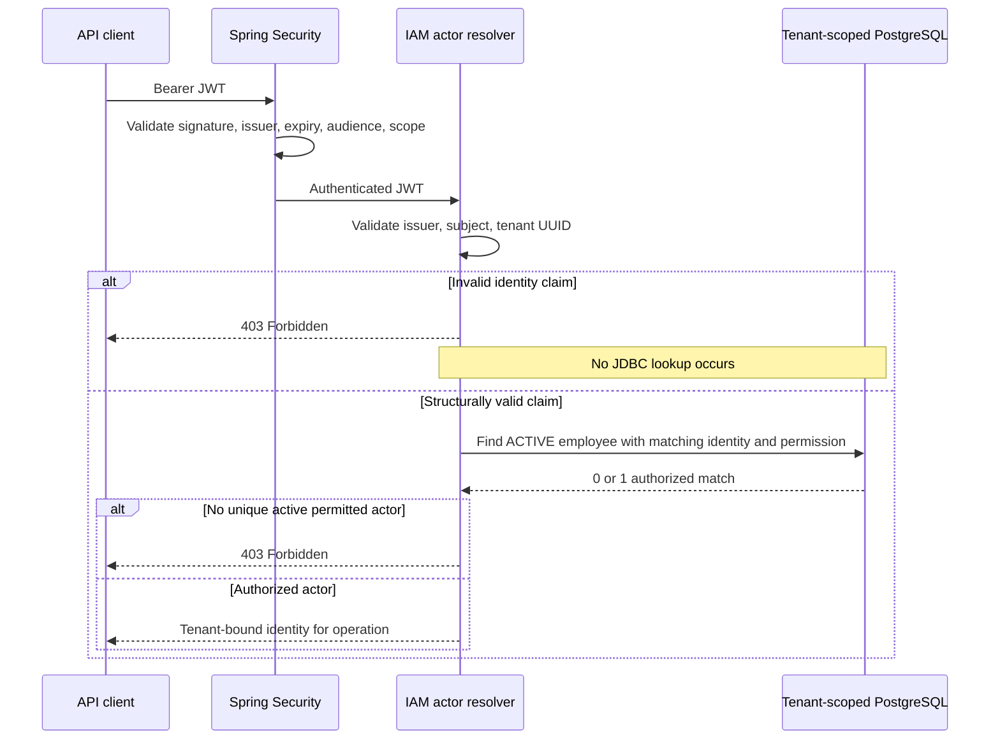

# Milestone 05A-3 — Adversarial IAM authorization tests

## Goal
Add executable negative tests for the identity-to-employee authorization boundary. Test that malformed JWT claims fail **before** database access, rather than relying on token shape or default tenant assumptions. Preserve existing production behavior and the verified 05A-2 SAST baseline.

## Architecture: layered identity trust


## What was implemented
- `ActorResolverInvalidClaimsTest`: tests **each of the three authorization resolvers** (access request, approval decision, quarantine reviewer).
- Seven negative cases per resolver: null JWT, absent issuer, absent subject, blank subject, absent tenant ID, blank tenant ID, malformed tenant UUID.
- Assert a 403 denial **and zero database interactions** for those inputs.
- Scope is intentionally **unit testing**, not cryptographic JWT validation or full HTTP integration testing.
- Preserve the existing signed-JWT test and HTTP integration suites as complementary layers; no production source code changed.

## Threat scenarios and use cases
| Case | Attack or error | Expected result |
| --- | --- | --- |
| IAM-AUTH-01 | Missing issuer | 403, no database access |
| IAM-AUTH-02 | Missing or blank subject | 403, no database access |
| IAM-AUTH-03 | Missing tenant ID | 403, no database access |
| IAM-AUTH-04 | Blank or malformed tenant UUID | 403, no database access |
| IAM-AUTH-05 | JWT absent entirely | 403, no database access |
| IAM-AUTH-06 | Validly signed token from untrusted key/issuer or incorrect audience | Rejected by decoder (existing `SignedJwtTrustValidationTest`) |
| IAM-AUTH-07 | Wrong tenant on approval request | 404/no mutation (existing `ApprovalDecisionHttpIT`) |
| IAM-AUTH-08 | Correct scope but missing employee approval permission | 403/no mutation (existing `ApprovalDecisionHttpIT`) |

## Why this is important
- **Fail closed:** missing claims must never resolve to a default tenant, identity, or permission.
- **Defense in depth:** a valid token signature is not proof of local employee identity or application authorization.
- **Evidence over assumption:** tests enforce the actual boundary and ensure invalid input does not reach the database.
- **Isolation:** tests use Mockito with zero database dependencies; existing integration tests exercise PostgreSQL for tenant isolation and transactional outcomes.

## Verification
```bash
mvn -B --no-transfer-progress -Dtest=ActorResolverInvalidClaimsTest test
mvn -B --no-transfer-progress clean verify
python3 -m unittest discover -s ops/keycloak -p 'test_*.py'
mvn -B --no-transfer-progress -DskipTests package spotbugs:check
```
Do not claim validation until CI runs on the PR. The mocked JWT objects are not proof of a valid JWS, and `jwt()` in Spring Security's MockMvc helper also bypasses real signature verification. Only dedicated cryptographic decoder tests establish signature/claim trust.

## Next security-testing increment
Build additional integration tests for forbidden/allowed HTTP paths, cross-tenant quarantine visibility, malformed claim responses and no-write invariants. Prefer extending existing `*IT` fixtures instead of creating a second complex database test harness.

## Interview questions
1. Why must we verify the identity's local employee binding after Spring verifies the JWT?
2. Why is `403 + verifyNoInteractions(jdbc)` stronger evidence than asserting only a 403?
3. What distinction exists between wrong-tenant `403` at actor lookup and `404` for a cross-tenant resource?
4. How would tests change if permissions were loaded from a cache?
5. Why are static-analysis findings and behaviorally executed adversarial tests complementary?
