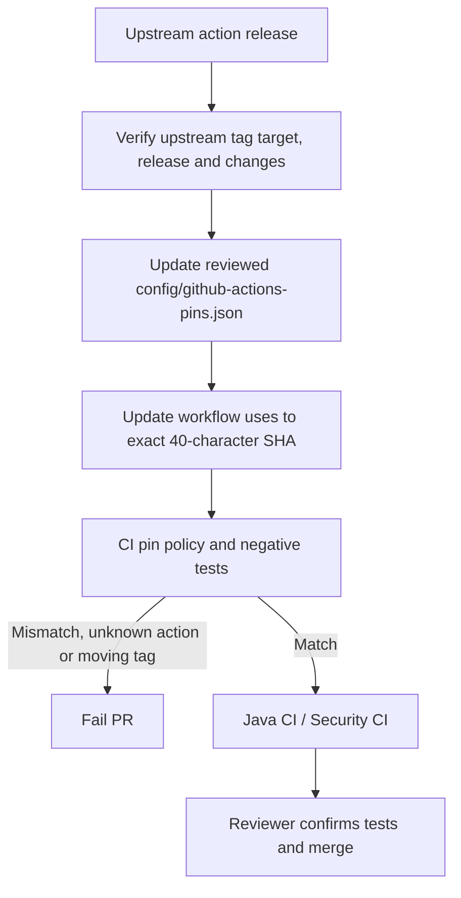

# Milestone 05B-2 — GitHub Actions supply-chain hardening

## Purpose and scope

Pin all remote GitHub Actions used by Java CI and Security CI to reviewed, immutable 40-hex-character Git commit SHAs instead of mutable version tags. Also move the previously deprecated Java setup action from v4 to v5, disable checkout credential persistence on Java CI, and enforce an independently testable pin policy. **No production IAM source, schema, runtime deployment or security finding exclusions are modified.**

## Why immutable pins matter

An action referenced by `@v6` or `@v3` can change as a maintainer advances the version tag, causing the same workflow source to execute different code on later runs. Referring to a specific commit SHA prevents that silent drift. SHA pinning does not independently prove that the commit is trustworthy, reviewed, signed or free from malicious code. Keep upstream release review, update governance, and permissions minimization as complementary controls.



## Exact reviewed action inventory (13 November 2026)

| Action | Reviewed label | Immutable commit | Notes |
| --- | --- | --- | --- |
| `actions/checkout` | v6 | `d23441a48e516b6c34aea4fa41551a30e30af803` | GitHub upstream `refs/tags/v6` returned this commit |
| `actions/setup-java` | v5 | `b6effb05e454b25005698d916606bdc6ffcbf961` | Updates deprecated v4; GitHub upstream `refs/tags/v5` returned this commit |
| `gitleaks/gitleaks-action` | v3 | `e0c47f4f8be36e29cdc102c57e68cb5cbf0e8d1e` | GitHub upstream `refs/tags/v3` returned this commit |
| `aquasecurity/trivy-action` | v0.36.0 | `ed142fd0673e97e23eac54620cfb913e5ce36c25` | Annotated tag `a9c7b0f06e461e9d4b4d1711f154ee024b8d7ab8` dereferenced to this commit; tag object had verified signature |

The inventory in `config/github-actions-pins.json` is the maintainable source of truth. SHA resolution was performed using GitHub's public Git ref API and annotated tag object where applicable. This verifies the reference target **at the time of inspection**; it is not independent attestation of the action contents.

## Implementation

- Update `.github/workflows/java-ci.yml` and `.github/workflows/security-ci.yml`: replace moving tags with reviewed immutable commit SHAs and retain human-readable version comments.
- Use `actions/setup-java` v5 in all jobs; preserve Temurin Java 25 and Maven caching.
- Set `persist-credentials: false` on the Java CI checkout; it was already disabled on security job checkouts.
- Preserve minimum `permissions: contents: read`; avoid `write-all`, `pull-requests: write` or granting unnecessary repository scopes.
- Use `ops/security/verify_github_actions_pins.py` to check every remote `uses:` reference in the two supported workflows against `config/github-actions-pins.json`. Reject unpinned versions, unknown remote actions and commit mismatches. Reject `docker://` references unless future policy implements digest support.
- Add negative Python unit tests in `ops/security/test_verify_github_actions_pins.py`; run both the policy validator and its tests in CI.

## Threat and verification use cases

| ID | Scenario | Enforced outcome |
| --- | --- | --- |
| SCM-01 | Upstream `v6` moves after approval | CI executes previously reviewed pinned SHA |
| SCM-02 | Contributor changes a workflow to `uses: actions/checkout@v6` | Pin validator fails |
| SCM-03 | Contributor pastes an arbitrary SHA not in inventory | Pin validator fails |
| SCM-04 | Contributor adds an unreviewed action | Pin validator fails |
| SCM-05 | Action versions are updated without updating the review inventory | Pin validator fails |
| SCM-06 | A job checks out the repository | Checkout credentials are not persisted in working tree credentials configuration |
| SCM-07 | Trivy's annotated tag resolves to a tag object | Pin the actual commit SHA, not the tag-object SHA |

## Reproducible local checks

```bash
python3 -m unittest discover -s ops/security -p 'test_*.py'
python3 ops/security/verify_github_actions_pins.py
python3 -m unittest discover -s ops/keycloak -p 'test_*.py'
mvn -B --no-transfer-progress clean verify
mvn -B --no-transfer-progress -DskipTests package spotbugs:check
```

Hosted acceptance: all four checks green on the PR head, including Java CI and the Security CI SAST job with the immutable pin validator.

## Update policy and limitations

1. Check upstream release notes, compatibility with GitHub runner Node runtime, permissions requirements and known security advisories.
2. Resolve the intended release/tag to the actual commit using GitHub API; if annotated, dereference the signed tag object to the commit.
3. Change the inventory record and workflow SHA together in a dedicated PR with evidence of the source version, reason for upgrade and risk review.
4. Run the policy tests plus the full Java and Security CI workflows. The reviewed inventory must be changed only with explicit reviewer approval.
5. Review action SHA pins periodically and after upstream security advisories. No automatic unreviewed version bumps.
6. Local repository actions are currently permitted by the validator and still require normal repository code review; container actions must be handled separately via image digests.
7. This is a simple text-based policy over the repository's currently known GitHub Actions files, **not a complete YAML parser**. If the repository adds another workflow, extend the `WORKFLOWS` inventory or redesign for automatic workflow discovery.

## Interview questions

**What attack does SHA pinning reduce?** A mutable major or release tag can be retargeted, silently changing code run in CI; a full immutable commit reference prevents this specific drift.

**Does pinning prove the action is safe?** No. You must still review provenance, risk, required permissions, and runtime effects.

**Why disable persist-credentials?** It reduces the chance that downstream build scripts or third-party tools can read or misuse the checkout authentication token.

**Why enforce policy both in tests and in CI?** Unit tests demonstrate rejection of unsafe references; CI enforces the exact repository manifest and workflow consistency.

**What remains for 05B-3?** Reproducible nonsecret security-evidence artifacts with commit identity, scanner metadata, test totals, checksums, and a documented retention/access policy.
