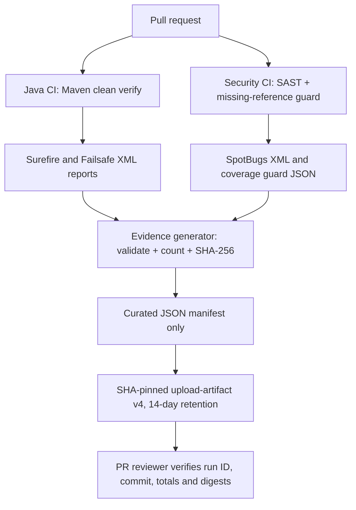

# Milestone 05B-3 — Reproducible CI security evidence

## Objective

Record **which commit and workflow attempt passed**, produce machine-readable counts and source-report SHA-256 digests, and retain only curated nonsecret evidence. The two evidence artifacts contain no raw logs, token values, database dumps, full scanner XML, or JUnit properties; those source files remain on the ephemeral hosted runner.

## Architecture



## Implementation — what, why, and how

1. `ops/security/create_ci_evidence.py` accepts the kind `java` or `sast`, source root, output path and GitHub run identity. It rejects invalid commit SHAs, invalid run IDs, missing reports, failed tests, missing SAST guard output, or malformed XML.
2. Java evidence aggregates `TEST-*.xml` from Surefire and Failsafe, including test-suite count, test count, failures, errors and skipped tests. Each individual report's SHA-256 is recorded by *relative path*; report contents are not uploaded. A failing or empty test set prevents publishing successful evidence.
3. SAST evidence records the SpotBugs XML digest and coverage-guard JSON digest, compiled-class **input** count, known unresolved-reference count and whether the guard passed. It does **not** mistake compiled class files for verified analyzer coverage.
4. Evidence includes the runner-provided `GITHUB_SHA`, `GITHUB_RUN_ID`, and `GITHUB_RUN_ATTEMPT`. On a pull-request workflow, `GITHUB_SHA` normally refers to the synthetic PR merge commit tested by that workflow; it may differ from the feature branch head. Reviewers must use the run's actual tested ref rather than assume they are identical.
5. Two new `actions/upload-artifact` steps publish only the generated JSON manifests for 14 days after the relevant validation succeeds. The action is pinned to the reviewed `v4` commit `ea165f8d65b6e75b540449e92b4886f43607fa02` and entered into `config/github-actions-pins.json`.
6. `ops/security/test_create_ci_evidence.py` tests correct summaries, rejection of failed/empty reports, cryptographic hashes and avoidance of raw sensitive report contents.

## Security and reliability use cases

| ID | Input / failure mode | Required behavior |
| --- | --- | --- |
| EVID-01 | Successful Java integration suite | Upload summary of test counts and report digests with run identity |
| EVID-02 | Empty or failed Java test suite | Reject successful-evidence publication |
| EVID-03 | SpotBugs clean with known unresolved analysis names | Record known-warning *count* and explicit status, not a claim of complete coverage |
| EVID-04 | New unresolved SpotBugs name or absent scan report | Fail CI before publishing a success manifest |
| EVID-05 | Test XML contains credentials or environment properties | Hash original report locally; upload **only** summary and digests, never XML content |
| EVID-06 | Mutable new upload action version | Pin to an immutable reviewed Git commit and enforce the action inventory |
| EVID-07 | CI rerun or pull-request merge ref | Record actual run ID, attempt and tested commit instead of relying on an ambiguous branch label |

## Reproducibility and verification

```bash
python3 -m unittest discover -s ops/security -p 'test_*.py'
python3 ops/security/verify_github_actions_pins.py
mvn -B --no-transfer-progress clean verify
# On an authorized CI run with a real GitHub commit SHA and run identity:
python3 ops/security/create_ci_evidence.py --kind java \
  --out target/security-evidence/java-evidence.json
```

SAST manifest creation additionally requires `target/spotbugs.xml` and `target/spotbugs-coverage.json`, the latter created by redirecting the successful coverage guard output in Security CI.

Review the uploaded manifest's `commit_sha`, `workflow_run_id`, attempt, counts and SHA-256 digests. Digests make later integrity comparisons possible if the original report has been retained separately; they cannot recover or verify a missing source report on their own. Do **not** describe a digest as cryptographic attestation of tool provenance.

## Retention and access controls

- Artifact retention is **14 days**, subject to repository/org policy and applicable GitHub limits; these manifests are **not permanent archives**.
- GitHub Actions artifact visibility follows GitHub repository and Actions permissions; do not assume a private artifact is invisible to all other repository readers.
- The workflow uploads only JSON manifests, never `target/surefire-reports`, `target/failsafe-reports`, `target/spotbugs.xml`, Maven logs, secrets or environment exports.
- Github Actions artifacts and logs can be downloaded by appropriately permitted actors; do not store secrets in the curated output. Review any future additions to the manifest schema before publishing.
- Maintain long-term evidence separately under an explicit retention policy if regulatory, legal or audit requirements arise. Current capstone artifacts are educational CI evidence, not signed SLSA provenance or formal compliance certification.

## Remaining limitations and next increment

These two manifests cover Java CI and SAST, **not full raw Trivy/Gitleaks machine-readable findings**. Their status is represented by separate green/red GitHub jobs, without asserting unavailable scanner internals. Future evidence hardening should capture appropriately redacted structured scanner summaries, trusted artifact attestations, update provenance and evidence comparison over time.

## Interview preparation

**Why not upload raw Surefire XML?** Test reports can contain system properties, inputs, stack traces or secrets. A curated summary provides reviewable quality-gate evidence with lower exposure.

**Why record report digests?** A SHA-256 links the summary to the exact input reports used on the runner, enabling integrity comparison if reports are independently retained.

**Why include run attempt?** Retried CI jobs can use the same workflow run ID but produce different execution evidence.

**Why isn't a green SpotBugs gate equivalent to complete analysis?** The analyzer still reports nine unresolved reference names. The manifest records the known limitation rather than claiming comprehensive analysis.
