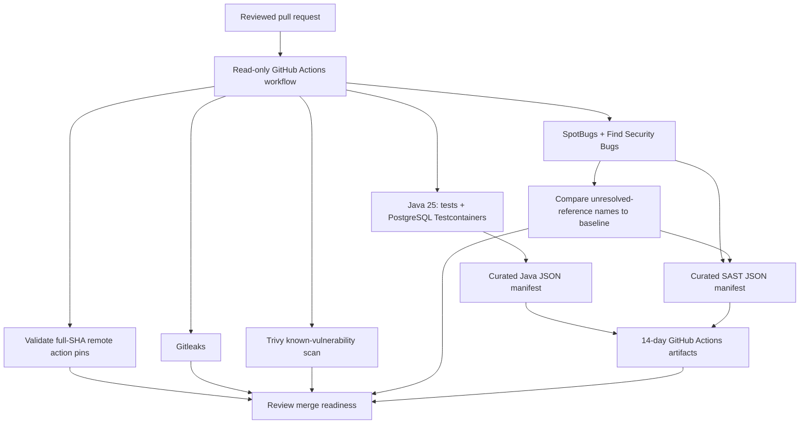

# Milestone 05B-4 — Security assurance verification and closeout

**System:** Enterprise Identity & Access Platform, educational IAM governance modular monolith  
**Baseline commit:** `729a8ad` on `main`, following PR #45 squash merge (2026-11-13)  
**Decision:** Milestone 05B is complete as an **implemented and CI-validated engineering control baseline**, with explicitly accepted residual risks. It is **not** proof of production readiness, a penetration test, complete static-analysis coverage, or security certification.  
**Scope:** 05B-1 analysis observability, 05B-2 workflow supply-chain controls, 05B-3 curated evidence, 05B-4 assurance review. This PR changes documentation only.

## 1. Executive summary and traceability

| Increment | Pull request | Verified implementation |
| --- | --- | --- |
| 05B-1 | [#43](https://github.com/asambataiden/enterprise-identity-access-platform/pull/43) | New SpotBugs missing-reference names fail a separate CI gate; XML readability and compiled input count checked; nine known unresolved names remain |
| 05B-2 | [#44](https://github.com/asambataiden/enterprise-identity-access-platform/pull/44) | Reviewed immutable 40-character action SHAs, `setup-java` v5, checkout without persisted credentials, CI policy validator and negative tests |
| 05B-3 | [#45](https://github.com/asambataiden/enterprise-identity-access-platform/pull/45) | Java/SAST JSON evidence manifests with run identity and SHA-256 report digests; SHA-pinned upload action; 14-day artifact retention |
| 05B-4 | This PR | Evidence review, residual risk/acceptance criteria, next-phase go/no-go decision, architecture and interview material |

Each of PRs #43–#45 had four passing hosted pull-request checks before merge (Java verify, Gitleaks, Trivy, SpotBugs/Find Security Bugs). **These results attest to the specific CI executions**, not to all possible configurations or future commits.

## 2. Architecture and trust boundaries



Scope restrictions: the workflow permissions remain read-only and checkout credentials are not persisted to the workspace. Artifact publication does not convey artifact authenticity, supply-chain provenance, or completeness of SAST analysis. Testcontainers tests exercise application behavior, but `jwt()` MockMvc helpers bypass signature validation; separate JWT decoder tests exercise offline cryptographic checks. Neither alone is live Keycloak interoperability proof.

## 3. Evidence register — distinguish observed facts from assumptions

| Evidence reference | Observed result | Appropriate interpretation |
| --- | --- | --- |
| [PR #43](https://github.com/asambataiden/enterprise-identity-access-platform/pull/43) | Four checks passed; coverage guard reported **48 compiled application class inputs**, **nine known unresolved reference names**, **zero new names** | Non-regression protection works; 48 compiled files are **not** an analyzed-class percentage. |
| [PR #44](https://github.com/asambataiden/enterprise-identity-access-platform/pull/44) | Four checks passed using full-SHA actions, including `actions/setup-java` v5 | Reviewed action refs are consistent with the approved inventory; pinning does not establish upstream code safety. |
| [PR #45](https://github.com/asambataiden/enterprise-identity-access-platform/pull/45) | Four checks passed; Java and SAST evidence publish steps succeeded | Both evidence-producing paths operated on the PR's tested commit; reports themselves are not persisted in uploaded artifacts. |
| [Java CI run 43456031624](https://github.com/asambataiden/enterprise-identity-access-platform/actions/runs/43456031624) | Artifact `java-evidence-43456031624-1`; GitHub ZIP digest `sha256:adac1ea41bed70a775961cede646270bac77ce2e180725f5a58254b7646f8193` | Published curated JSON, not raw XML; ZIP digest is distinct from report digests inside JSON. |
| [Security CI run 43456031602](https://github.com/asambataiden/enterprise-identity-access-platform/actions/runs/43456031602) | Artifact `sast-evidence-43456031602-1`; GitHub ZIP digest `sha256:13738777dfb4a77e389c441ad6b7a5fe78d000acb2c9dcd481e986c0542fe355` | Published curated SAST JSON; success does not imply full bytecode/classpath resolution. |

Both observed PR #45 artifacts had an expiry of **2026-11-27** under the configured 14-day retention. An expired artifact must not be described as retrievable forever. The artifact ZIP digest is not a signed artifact attestation.

**Identity caveat:** In pull-request workflows `GITHUB_SHA` may designate a synthetic merge commit rather than the feature-branch head. For forensic comparison, inspect the workflow run's commit/ref and the manifest `commit_sha` rather than conflating them.

## 4. Control inventory and limitations

| Control | Implementation | Limits / review trigger |
| --- | --- | --- |
| SAST findings | SpotBugs + Find Security Bugs and `config/spotbugs-exclude.xml` | There are 16 explicitly scoped XML matches from 05A; periodically inspect the unfiltered report. No blanket conclusion that exclusions are benign forever. |
| Analyzer coverage regression | `ops/security/verify_spotbugs_coverage.py` plus nine-name inventory | Fails on **new** unresolved-reference names, not on nine known baseline names. Input compiled classes do **not** prove bytecode analysis completeness. |
| Supply-chain action pinning | `config/github-actions-pins.json`, validator and negative tests | Static text parser currently covers two named workflow files. New workflows and locally referenced actions need explicit additional review. |
| Secure checkout | GitHub Actions checkout with `persist-credentials: false`; `contents: read` | Review permissions and checkout configuration whenever workflow jobs are changed. |
| Secrets/SCA | Gitleaks and Trivy | A passing scan covers configured detectors, dependency database and severity policies for that execution only. |
| Evidence integrity | `ops/security/create_ci_evidence.py` and SHA-256 report digests | Manifests enable correlation and later comparisons, but source XML is not retained for later recomputation; generated JSON is not signed provenance. |
| Evidence exposure | Curated manifests only, uploaded via reviewed action SHA | Review future schema changes for leakage; artifact access depends on repository permissions. |
| Retention | 14-day upload-artifact setting | Not a permanent audit archive; future compliance needs explicit access and retention policy. |

**Documentation consistency note:** The 05B-1 learning document has an outdated `SAST-COV-03` sentence suggesting XML without class-summary/project-JAR metadata is automatically rejected. The implemented validator instead accepts minimal well-formed `BugCollection` XML with a completed analyzer log and compiled input files; it rejects absent/invalid reports, empty compiled input, and new missing names. This closeout states the implemented behavior. Correct that sentence as part of this closeout to avoid contradictory interview explanations.

## 5. Residual risk register (prioritized)

| ID / priority | Open risk | Owner role | Acceptance criterion before claiming resolution |
| --- | --- | --- | --- |
| R-01 / High | Nine unresolved names in SpotBugs warnings | Security engineering | Reproduce and investigate auxiliary classpath, lambda/invokedynamic/Java 25 support and the relevant bytecode; document before/after warnings and verified analyzer result. Baseline inventory must not be expanded merely to get green CI. |
| R-02 / High | Sixteen SAST exclusions need independent unfiltered review | AppSec + backend owner | Collect an unfiltered SpotBugs report, match each warning to exact class/rule, record justification/owner/review date and eliminate stale or overbroad exceptions. |
| R-03 / High | Live IdP token trust not end-to-end exercised | Identity engineering | Start real Keycloak in a controlled test environment; verify signed valid and invalid tokens via the actual HTTP bearer filter chain (issuer, audience, expired, wrong key, tenant/permission). No live secrets in repo. |
| R-04 / High | Workflow pin policy is text-based and scoped to two files | DevSecOps/platform owner | Inventory all workflow files and composite/local actions, cover reusable workflows and `docker://` digest policy; test bypass patterns and workflow permissions. |
| R-05 / Medium | Raw scanner reports unavailable after hosted runner execution | Security engineering | If required, retain appropriately sanitized/restricted evidence with clear access, provenance, retention and comparison tests. Never upload secret-bearing raw logs. |
| R-06 / Medium | Artifact signatures / attestation are absent | Platform security | Adopt verifiable provenance with approved OIDC permissions and explicit trust policy only when required by target delivery. |
| R-07 / Medium | No operationally tested permission revocation races | Backend/identity engineering | Introduce targeted concurrency/race scenarios and validate no unauthorized durable mutation. |
| R-08 / Medium | Sporadic test environment PostgreSQL SSL startup faults previously reported | CI maintainer | Reproduce, isolate environmental cause and fix without relaxing production TLS expectations. |

No risk is silently closed by this documentation-only PR. Record concrete follow-up issues when implementing each remediation.

## 6. Go/no-go decision for next platform increment

**GO for additional educational platform development and security test increments**, under the existing PR + four-check merge discipline, because known limitations are documented and CI guards remain enforced.

**NO-GO for statements of production IAM readiness or comprehensive security assurance**, until high-priority risks are addressed and the deployment threat model, live identity integration, operations, auditing, secrets lifecycle and authorization concurrency are assessed.

Proposed next vertical slice: **Milestone 06 — Real identity-provider interoperability and authorization contract validation**. Begin with an isolated, reproducible Keycloak-backed test environment, real signed bearer-token validation at the HTTP layer, negative issuer/audience/key tests and tenant-bound authorization behavior. Defer broader platform architecture additions until this security trust boundary is demonstrated.

## 7. Reproducible verification procedure

```bash
git switch main
git pull --ff-only origin main

python3 -m unittest discover -s ops/security -p 'test_*.py'
python3 ops/security/verify_github_actions_pins.py
python3 -m unittest discover -s ops/keycloak -p 'test_*.py'

mvn -B --no-transfer-progress clean verify
set -o pipefail
mvn -B --no-transfer-progress -DskipTests package spotbugs:check 2>&1 | tee /tmp/iam-spotbugs.log
python3 ops/security/verify_spotbugs_coverage.py \
  --log /tmp/iam-spotbugs.log \
  --xml target/spotbugs.xml \
  --classes target/classes \
  --baseline config/spotbugs-missing-baseline.json
```

Locally, `create_ci_evidence.py` requires valid CI identity fields; a run outside GitHub must supply explicit `--sha`, `--run-id` and `--attempt` values. CI artifacts are published only after successful verified jobs. Record exact SHA, run ID, attempt and checks for each subsequent milestone.

## 8. Use cases and interview discussion

**SC-05B-01 — A new unresolved reference appears:** SpotBugs can still report zero detectable vulnerabilities, while the independent completeness guard fails the job and requires analysis of classpath / bytecode.

**SC-05B-02 — Action tag is moved upstream:** CI continues executing the pinned reviewed commit. The next desired version requires changing both SHA and approved inventory under review.

**SC-05B-03 — JUnit report contains internal properties:** The manifest stores aggregate counts and SHA-256 digests, not the report's content. Restrict future JSON fields so a schema change cannot introduce secrets.

**SC-05B-04 — Artifact disappears after retention:** A retained manifest or historical PR comment can establish what was once published, but without retained source reports or signed provenance a later verifier cannot independently replay that exact scan.

**Interview: Why isn't a green CI run sufficient for security certification?** It proves configured checks passed for a specific commit and environment, not that the scanner analyzed all bytecode, threats were exhaustively tested or deployment controls are correctly implemented.

**Interview: Why keep both risk and evidence registers?** Evidence traces observed controls and their limitations; the risk register records unresolved threats, accountable roles and the testable conditions for closure.

**Interview: Why start Milestone 06 with actual token verification?** MockMvc principal injection skips cryptographic verification. A real OAuth2 resource-server path checks a critical boundary before external integrations and production deployment are added.

## 9. Closeout acceptance checklist

- [x] PRs #43–#45 merged into `main` with four successful pull-request checks each
- [x] Known nine SpotBugs unresolved names inventoried; new-name regressions blocked
- [x] Action version tags replaced by immutable reviewed commits; CI pin policy tested
- [x] Java and SAST manifests successfully published and artifact expiration verified
- [x] Documentation of exact evidence, threat model, limitations and residual risks
- [ ] Live signed-token HTTP interoperability proven — deferred to Milestone 06
- [ ] Unfiltered SpotBugs suppression review and full analyzer diagnosis — tracked as risk
- [ ] Production readiness/security certification — **not claimed**

**Closeout position:** 05B controls are implemented and validated within their stated scopes. Proceed with the next educational increment, but do not equate this milestone with complete IAM security assurance.
