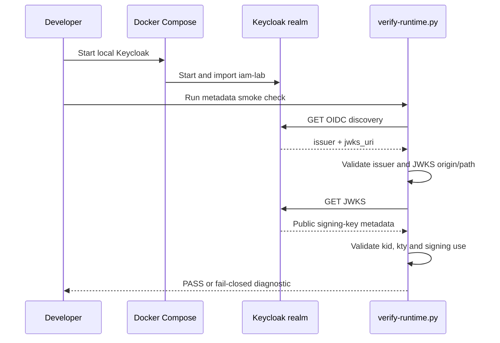

# Milestone 06A — Keycloak runtime metadata smoke check

## Objective

Establish a repeatable, credential-free runtime check for the local Keycloak identity provider before adding real access-token tests. This increment validates OIDC discovery and the realm signing-key endpoint only. It does **not** claim end-to-end authentication or authorization.

## Why this is a separate increment

The repository already has:
- a local Keycloak 26.8.2 Compose service and imported `iam-lab` realm;
- Spring Resource Server configuration with an expected issuer, JWKS URI and audience;
- offline RSA signature/issuer/audience/expiry tests;
- HTTP authorization tests using Spring Security's mock JWT request post-processor.

Those tests cover different boundaries. A mock JWT bypasses cryptographic token parsing in the HTTP test; the offline decoder test does not exercise the running Keycloak service or the application's HTTP filter chain. 06A makes the identity provider's runtime metadata an independently observable prerequisite.

## Implementation

`ops/keycloak/verify-runtime.py` uses only the Python standard library. It:
1. retries the local discovery endpoint to tolerate Keycloak startup time;
2. requires the discovered issuer to exactly match `IAM_JWT_ISSUER_URI`;
3. requires the JWKS URL to remain on the configured Keycloak origin and inside the expected realm path;
4. requires at least one signing-key entry with `kid`, `kty` and signing use;
5. prints metadata-only results and never requests credentials, user tokens or private keys.

The origin/path checks are deliberate: a compromised or misconfigured discovery response must not silently redirect this lab check to an unrelated key server.

## Runbook

From the repository root:

```bash
export IAM_LAB_ADMIN_USERNAME='admin'
export IAM_LAB_ADMIN_PASSWORD='use-a-local-lab-only-password'

docker compose -f ops/keycloak/compose.yaml up -d
docker compose -f ops/keycloak/compose.yaml ps

python3 ops/keycloak/verify-runtime.py

docker compose -f ops/keycloak/compose.yaml logs --tail=100 keycloak
```

Use a local-only password; do not commit it, put it in shell history where other users can read it, or reuse a production credential. The compose service binds to loopback. Do not expose `start-dev` to a network or treat this realm as production configuration.

Cleanup when finished:

```bash
docker compose -f ops/keycloak/compose.yaml down
```

## Expected result

A successful run reports:
- discovery reachable;
- exact issuer match;
- same-origin, realm-scoped JWKS endpoint;
- one or more signing-key metadata entries.

A failure is a hard stop for later live-token tests. Diagnose Keycloak startup, realm import, port binding, issuer configuration or JWKS metadata. Do not bypass the check or weaken issuer validation to make it pass.

## Architecture and sequence



## Use cases

- **Local onboarding:** confirm that a developer's Keycloak realm is ready before running integration tests.
- **Configuration drift:** detect a realm/issuer mismatch before investigating application-level 401 responses.
- **JWKS outage or import failure:** detect unavailable or empty signing-key metadata early.
- **Trust-boundary regression:** reject metadata that points outside the expected Keycloak origin or realm path.

## Security boundaries and limitations

- JWKS contains public keys; this script does not access or expose private signing material.
- A reachable JWKS endpoint does not prove a token is valid.
- This increment does not test token signature verification, issuer/audience/expiry rejection through the HTTP filter chain, scopes, tenant mapping, local permissions, revocation, key rotation or production TLS.
- The local realm uses `start-dev` and `sslRequired: none`; it is strictly a developer lab.
- Runtime checks are intentionally not part of hosted CI because GitHub-hosted CI does not start this developer's local Keycloak instance.

## Acceptance criteria

- [ ] Local Keycloak starts using the documented Compose command.
- [ ] Runtime script exits 0 for the expected realm and non-empty signing JWKS.
- [ ] Wrong issuer configuration fails.
- [ ] Unavailable Keycloak fails after bounded retries with a non-zero exit.
- [ ] No secrets or access tokens are emitted.
- [ ] Java CI and security CI remain green.

## Learning notes

**OIDC discovery** publishes provider metadata, including issuer and endpoint locations. The issuer is an identifier, not merely a hostname; exact matching matters because JWT validation binds tokens to that issuer.

**JWKS** is a set of public keys used by a relying party/resource server to verify signed JWTs. The `kid` header helps select a key during rotation. The resource server must still validate the token's signature and claims.

**Readiness is not trust.** This smoke check establishes that metadata is reachable and structurally plausible. Only the next increment can prove that a Keycloak-issued token is accepted or rejected correctly by the running application.

## Next increment

06B will acquire a short-lived access token from the local realm using a deliberately provisioned synthetic test identity and send it through the real Spring Security HTTP filter chain. It must validate the actual access token (not an ID token), audience, issuer, expiration and expected authorities, with negative cases. The test must remain opt-in/local until a deterministic, isolated CI identity-provider service is deliberately introduced.
