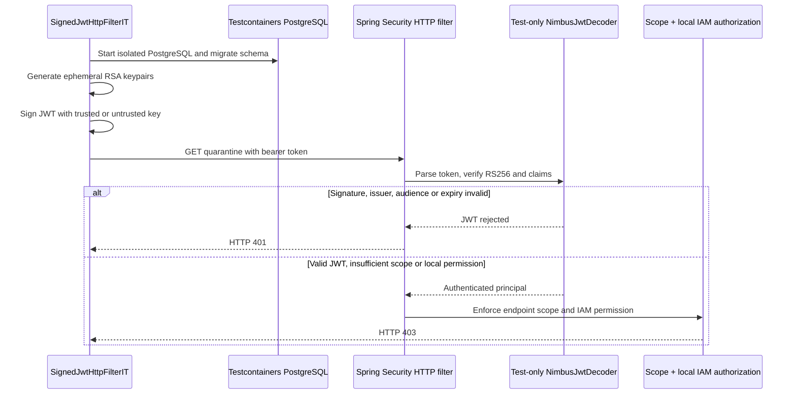

# Milestone 06B-2 — Deterministic signed-JWT HTTP security regression

## Objective and delivery constraint

Continue the IAM capstone without depending on the blocked local Keycloak administrator password, browser callback or a live identity-provider container. This increment adds **cryptographically signed test JWTs** through the application's real Spring Security servlet filter chain, using the existing Testcontainers PostgreSQL integration-test infrastructure.

This does not change production authentication logic, create test administrators, or add a new OAuth grant type.

## Existing evidence and new boundary

Previously:
- `SignedJwtTrustValidationTest` checks signature, issuer, audience and expiry at the **decoder** layer.
- Existing HTTP integration tests use `spring-security-test` `jwt()`, which substitutes an authenticated JWT principal and therefore **bypasses signature verification**.
- 06A proves local OIDC discovery and public JWKS reachability.
- Draft PR #49 adds a browser-assisted live access-token smoke check, currently blocked by synthetic-login/admin credential recovery.

New `SignedJwtHttpFilterIT` combines a real signed bearer string with the **actual servlet filter chain** and a test-only `NimbusJwtDecoder`. The test signs JWTs using freshly generated in-memory RSA keys, validates exact issuer and expected audience, and verifies HTTP 401 versus 403 responses.

## Scenarios

| Request | Expected | Why |
|---|---|---|
| No bearer | 401 | Authentication required |
| Invalid bearer format | 401 | Fail closed at parsing |
| Signed with an unknown RSA key | 401 | Reject invalid signature |
| Trusted signature, wrong issuer | 401 | Reject issuer impersonation |
| Trusted signature, wrong audience | 401 | Reject token substitution |
| Expired access token | 401 | Reject stale authentication |
| Valid token, missing `provisioning:review` scope | 403 | Authentication is not authorization |
| Valid token + scope, but no locally authorized employee | 403 | Keycloak scope alone does not grant tenant permission |

All requests are **GET /api/v1/provisioning/quarantine** and do not trigger provisioning or approval mutations. No JWT values, test private keys or passwords are committed or printed.

## Architecture



## Runbook and acceptance criteria

Run from repository root:

```bash
mvn -B --no-transfer-progress -Dtest=SignedJwtTrustValidationTest -Dit.test=SignedJwtHttpFilterIT verify
```

This requires a functioning Docker/Testcontainers environment for PostgreSQL but no Keycloak service, browser, synthetic user or preconfigured admin password. The normal `mvn clean verify` in GitHub Actions also discovers `*IT.java` through Failsafe.

Acceptance requires the Java CI and Security CI checks to be green; do not merge if this new suite fails. Record the exact CI run and commit as evidence.

## Limitations and next steps

- The JWT decoder is intentionally **overridden only in this test context** using `@TestConfiguration` and `@Primary`, with a test-generated public key and claim validators. This proves servlet authentication/authorization wiring and cryptographic rejection, but **does not prove production JWKS discovery, production JWT decoder auto-configuration or actual Keycloak token compatibility**.
- It does not assert successful `200` authorization for a fully seeded reviewer. That path is covered with mocked principals in existing HTTP tests; upgrade to a signed-token positive path only if needed for release acceptance.
- It is not a substitute for production TLS, key rotation tests, revocation strategy or live browser interoperability.
- Leave PR #49 in draft. Address the real Keycloak acceptance gate later, separately and with a strict troubleshooting time box.
- Continue with a release-focused checklist and operational readiness rather than expanding authentication scope without limits.

## Interview explanation

**Why both 401 and 403?** `401` means the resource server cannot accept the bearer identity. `403` means an authenticated identity is denied by API scope or local IAM policy. Treating these as interchangeable hides trust-boundary regressions.

**Why use an ephemeral private key?** Deterministic in-CI negative cases must not require external identity-provider credentials, and test keys must not be distributed or reused as application signing keys.

**What is still unproved?** The production JWKS-to-decoder configuration and real Keycloak-issued token processing. Report this openly in the release notes rather than silently promoting a mock-backed test to interoperability evidence.
