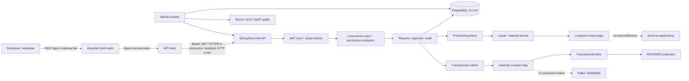
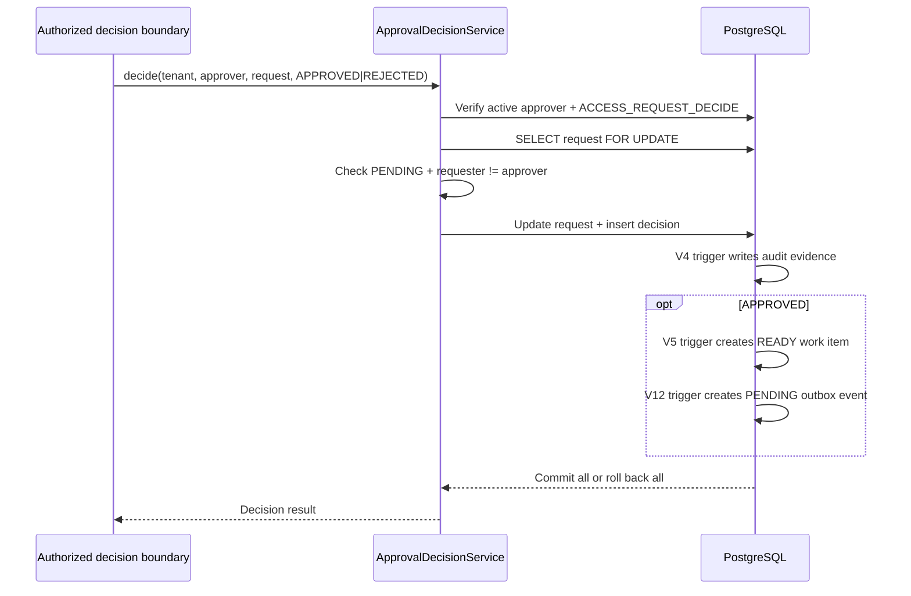

# Complete Engineering Guide — Enterprise Identity & Access Management Platform

**Portfolio release:** `v0.1.0-portfolio`  
**Release commit:** `cf0e2fce324fa6c81bf5bccc4ee49dadf1925391`  
**Classification:** educational, local/test-only IAM governance platform; not production-ready or independently security-audited.

This guide is the project-wide learning and interview companion. It consolidates the implemented journey, use-case catalogue, technology choices, architecture, transaction and security flows, verification strategy, and explicit non-goals. The individual milestone documents remain the detailed implementation record and source of truth for each increment.

> **Evidence vocabulary:** “Implemented” means repository code and scoped tests exist. “Observed” means a local or hosted run produced recorded output. “Simulated” means a controlled mock/test target was used. “Not implemented / unverified” must never be upgraded to “production-ready” by inference.

## 1. Executive summary

The platform models a controlled employee application-access governance workflow:

1. An authorized tenant employee requests an application role for another employee in the same tenant.
2. The request is persisted with tenant ownership and idempotency invariants.
3. A distinct authorized approver makes an approval or rejection decision.
4. The decision and audit evidence are committed transactionally.
5. An approved decision creates durable provisioning intent—not an entitlement grant.
6. A simulated worker uses leases, fencing, attempt evidence and a loopback mock target to demonstrate safe retries and reconciliation.
7. A transactional outbox/relay/inbox path demonstrates at-least-once delivery and idempotent local projection.
8. Quarantine inspection and review evidence support diagnosis without silently requeueing or granting access.
9. Security CI validates Java tests, secret detection, dependency vulnerabilities, static analysis and workflow pin policy.

**The system does not grant real access to external applications.** The mock target, simulated entitlement, `RECEIVED` projection and `DELIVERED` event state are local workflow evidence. They do not prove that an employee can sign in to or use a downstream application.

## 2. Business problem and actors

### Problem

Enterprises need to control who may request access, who may approve it, which tenant owns the employee and application, how decisions are evidenced, and how downstream work can be retried safely. A valid login alone must not authorize arbitrary access.

### Actors

| Actor | Responsibility | Boundary |
|---|---|---|
| Requester | Creates a request for a tenant-local employee | Must have active local employee mapping and request permission |
| Subject employee | Person for whom access is requested | Must belong to the same tenant and meet eligibility rules |
| Approver | Approves or rejects a pending request | Must be distinct from requester and have local decision permission |
| Quarantine reviewer | Inspects failed simulated work | Read-only HTTP inspection; review journal is not a production remediation API |
| Identity provider | Authenticates user and issues signed token | Keycloak is not the business entitlement authority |
| IAM API | Enforces tenant/resource policy and persists governance | Does not mint tokens or store user passwords |
| Simulated target | Exercises apply/readback/retry contract | Loopback mock only; no external system is mutated |
| CI reviewer | Reviews code, test and security evidence | Green checks apply to a specific commit and configured controls |

## 3. Use-case catalogue

The repository has one original formal business use-case document (UC-001). The additional entries below are implementation/security scenarios consolidated from the milestone acceptance tests; they are not separate formal product specifications.

| ID | Use case / scenario | Expected outcome | Implementation status |
|---|---|---|---|
| UC-001 | Tenant administrator requests an application role for a same-tenant employee | Persist one tenant-bound PENDING request; reject invalid actors/targets | Core intake implemented and tested; live Keycloak positive authorization remains unverified |
| UC-001-A | Retry the same request with same tenant/idempotency key and same terms | Return/converge on the same logical request | Implemented and PostgreSQL-tested |
| UC-001-B | Reuse idempotency key with changed request terms | Conflict; preserve original request | Implemented and tested |
| IAM-AUTH-01 | Anonymous or malformed bearer request | 401 at bearer boundary; no business write | Implemented/tested |
| IAM-AUTH-02 | Invalid signature, issuer, audience or expired signed JWT | Reject authentication (401) | Offline RSA tests and real Spring HTTP filter tests with test-only decoder |
| IAM-AUTH-03 | Valid identity but missing scope | 403; no write | Implemented/tested |
| IAM-AUTH-04 | Valid token claims but missing/invalid tenant, issuer or subject | Fail closed before DB actor lookup | Three resolver unit suites verify 403 and zero JDBC calls |
| IAM-AUTH-05 | Token identity not mapped to an active local employee with permission | 403; no write | Implemented/tested in controlled scenarios |
| IAM-TENANT-01 | Request/decision/review references another tenant | Deny without leaking foreign resource existence or mutating data | Composite DB constraints and HTTP/service tests |
| IAM-SOD-01 | Requester attempts to approve their own request | Deny; request remains pending | Service, DB and HTTP regression tests |
| IAM-APR-01 | Authorized distinct approver approves a pending request | Atomic decision and request-state update | Implemented/tested |
| IAM-APR-02 | Approver rejects request | REJECTED; no provisioning work item | Implemented/tested |
| IAM-APR-03 | Two approvers race on one pending request | One legal transition and one decision record | PostgreSQL concurrency tests |
| IAM-AUD-01 | Decision commits | Matching audit event commits in same transaction | V4 trigger and integration tests |
| IAM-PROV-01 | Approved request enters provisioning workflow | Create READY work item; no real grant | Implemented |
| IAM-PROV-02 | Worker claims work while another worker competes | One active lease; token fences stale workers | Implemented/tested with PostgreSQL row locks |
| IAM-PROV-03 | Worker crashes, times out or repeatedly fails | Retry with bounded attempts/backoff; quarantine after limit | Implemented/tested |
| IAM-PROV-04 | Mock target accepts a write but acknowledgement is lost | Read before retry; use stable idempotency key and independent readback | Loopback mock contract and orchestrator tests |
| IAM-QUAR-01 | Operator inspects quarantined request | Tenant-scoped, bounded, read-only diagnostic view | Internal inspector and read-only HTTP route implemented |
| IAM-QUAR-02 | Reviewer records HOLD / ESCALATE / RECONCILE_REQUIRED | Structured evidence only; no lease reset or entitlement mutation | Internal journal tested; authenticated production reviewer workflow not implemented |
| IAM-EVENT-01 | Approval creates provisioning intent | Outbox event committed atomically with DB business transaction | V12 implemented |
| IAM-EVENT-02 | Relay publishes and crashes before acknowledgement | Lease expiry permits redelivery; immutable event ID retained | V13 relay contract implemented; no broker configured |
| IAM-EVENT-03 | Consumer receives same event twice | Inbox receipt and local projection applied once | V14 implemented/tested |
| IAM-EVENT-04 | Consumer unavailable or payload conflicts | Retry or fail closed; do not mark delivered incorrectly | Integration tests |
| IAM-CI-01 | Secret pattern enters Git history | Gitleaks gate fails | Hosted CI |
| IAM-CI-02 | High/critical dependency vulnerability detected | Trivy gate fails | Hosted CI |
| IAM-CI-03 | Java source/bytecode security finding appears | SpotBugs/Find Security Bugs gate evaluates and blocks unexcluded findings | Hosted CI; known coverage/exclusion residual risks documented |
| IAM-CI-04 | New unresolved SpotBugs reference appears | Coverage regression guard fails | Python validator and baseline |
| IAM-CI-05 | Workflow action tag is mutable or unapproved | Full-SHA inventory validator fails | Implemented for the two configured workflow files; broader parser scope remains a residual risk |
| IAM-CI-06 | Test or SAST evidence is empty/failed | Do not publish a success manifest | Evidence generator tests and CI integration |
| IAM-OPS-01 | Developer needs a repeatable demo without Keycloak credentials | Run curated isolated Testcontainers suite | `ops/demo/run-portfolio-demo.sh` |
| IAM-IDP-01 | Verify local Keycloak discovery/JWKS metadata | Validate expected issuer and same-origin realm JWKS | Local runtime smoke script; metadata only |
| IAM-IDP-02 | Validate a real Keycloak-issued access token end-to-end | Browser PKCE, token, actual configured API resource server | Open draft PR #49; blocked/unverified; not a release claim |

### Important state vocabulary

- `PENDING`: request awaits a decision.
- `APPROVED` / `REJECTED`: governance decision.
- `READY`, `LEASED`, `RETRY_WAIT`, `QUARANTINED`: provisioning-work orchestration states.
- `STARTED`: durable attempt-start evidence.
- `VERIFIED` / `ABSENT` / `UNKNOWN`: observation on the local mock target.
- `RECEIVED`: consumer has atomically recorded the event and its local projection.
- `DELIVERED`: relay received a normal acknowledgement from its configured publisher contract.

None of the above is equivalent to a real external entitlement being effective. The `SUCCEEDED` state in the earlier simulation is specifically tied to a synthetic database entitlement, not a real downstream grant.

## 4. Technology stack — what, how and why

Versions below reflect the repository's pinned build/workflow configuration at the portfolio release. Do not assume every technology is deployed as an independent production service.

| Layer | Technology | How it is used | Why it was selected |
|---|---|---|---|
| Language/runtime | Java 25 | Main application and test code | Strong typing, mature JVM ecosystem, current LTS baseline |
| Application framework | Spring Boot 4.1.2 | Single deployable REST application, configuration, lifecycle | Convention-based wiring and mature production patterns |
| HTTP | Spring MVC / WebMVC | REST controllers and servlet filter chain | Clear synchronous API boundary and integration with Spring Security |
| Authentication boundary | Spring Security OAuth2 Resource Server | Bearer JWT parsing and trust validation | Delegate authentication to a dedicated IdP; avoid custom token/password implementation |
| Identity provider | Keycloak 26.8.2 local lab | OIDC discovery, JWKS and synthetic realm/user experiments | Standards-based local IdP; lab only, not production deployment |
| Persistence | PostgreSQL 17 | Tenant-scoped relational data, constraints, locks, JSONB event envelope | Strong transactional and relational integrity features |
| Database evolution | Flyway V1–V14 | Ordered, versioned SQL schema migrations | Reproducible schema evolution; applied migrations remain immutable |
| Data access | Spring JDBC / JdbcTemplate | Explicit SQL, row locking, tenant-bound queries | Visible SQL and transaction boundaries for governance-critical logic |
| Build | Maven | Dependency resolution, lifecycle, Surefire/Failsafe, SpotBugs | Reproducible Java build and separate unit/integration test phases |
| Unit tests | JUnit via Spring Boot Test | Service, state-machine, resolver, security tests | Fast feedback on deterministic logic |
| Mocking | Mockito | Mock principal dependencies, JDBC interaction assertions | Isolate policy branches and prove no DB interaction for malformed claims |
| HTTP tests | MockMvc / Spring Security Test | Route, status, scope and no-write regressions | Exercise actual MVC/security configuration; mock JWT principal does not test signature |
| Integration infrastructure | Testcontainers PostgreSQL | Disposable PostgreSQL 17 per integration scenario | Real database semantics without mutating local IAM lab DB |
| Signed JWT tests | Nimbus/Spring Security decoder + ephemeral RSA keys | Signature, issuer, audience, expiry and HTTP filter negative tests | Cryptographic test coverage without live IdP credentials |
| Local mock transport | JDK HTTP client + loopback JDK HttpServer test fixture | Apply/readback and lost-acknowledgement behavior | Exercise network uncertainty while preventing arbitrary external targets |
| Secret scanning | Gitleaks | Scan full Git history in CI | Detect accidental credential commits |
| Dependency scanning | Trivy v0.36.0 | Filesystem/dependency inventory; fail on HIGH/CRITICAL | Detect known vulnerable components in configured scan scope |
| SAST | SpotBugs 4.10.5.0 + Find Security Bugs 1.12.0 | Java bytecode/static security analysis | Find likely code defects/security patterns before runtime |
| SAST coverage guard | Python standard library | Validate report readability and regression in unresolved analysis references | Prevent silent degradation of analyzer inputs; does not prove complete coverage |
| CI | GitHub Actions | Java verify and separate security gates on PR and main pushes | Repeatable, review-gated validation |
| CI supply-chain | Full-SHA action pins + Python policy validator | Pin approved action commits in workflow files | Reduce mutable-tag risk; policy scope is currently limited to inventoried files |
| Evidence | Python JSON manifest generator + SHA-256 | Curated test/SAST metadata and report digests | Correlate evidence with SHA/run/attempt without uploading raw reports |
| Local runtime | Docker Compose | Optional local Keycloak and PostgreSQL lab services | Reproducible isolated developer lab; not required for the curated demo |

### Technologies deliberately not claimed as implemented

Kafka, RabbitMQ, Kubernetes, cloud deployment, Terraform, service mesh, SCIM provisioning, production secrets manager, production SIEM, distributed tracing, HA PostgreSQL, multi-region deployment, and real target-system connectors are not part of this release. They should be introduced only with a concrete use case, threat model, operational owner and acceptance test.

## 5. Architecture and component responsibilities

### 5.1 System context



Solid application paths represent implemented code/test relationships. Dotted paths are intentionally unavailable production integrations. The diagram is conceptual, not a deployment topology.

### 5.2 Modular monolith

```text
dev.asambataiden.iam
├── bootstrap/
│   └── BootstrapSecurityConfiguration
├── accessrequest/
│   ├── AccessRequest / AccessRequestService
│   ├── AccessRequestController
│   ├── RequestActorResolver
│   ├── ApprovalDecisionService / ApprovalDecisionController
│   └── DecisionActorResolver
└── provisioning/
    ├── execution/
    │   ├── ProvisioningLeaseService
    │   ├── SimulatedProvisioningService
    │   ├── MockProvisioningOrchestrator
    │   └── ProvisioningAttemptJournal
    ├── target/
    │   ├── ProvisioningTargetAdapter
    │   ├── LoopbackHttpProvisioningTargetAdapter
    │   └── MockTargetObservationJournal
    ├── quarantine/
    │   ├── ProvisioningRecoveryInspector
    │   ├── QuarantineInspectionController
    │   ├── QuarantineReviewActorResolver
    │   └── QuarantineReviewJournal
    ├── outbox/
    │   ├── OutboxDeliveryService
    │   ├── OutboxEventPublisher
    │   ├── OutboxRelay
    │   └── InProcessInboxPublisher (test-only)
    └── inbox/
        └── ProvisioningInboxConsumer
```

**Why one deployable?** The hardest early requirements are tenant isolation, transaction integrity and authorization correctness. A modular monolith keeps these boundaries testable without adding network trust, distributed tracing, deployment orchestration and cross-service consistency prematurely. Package boundaries are organizational; they are not separate deployable services.

### 5.3 Request and approval sequence

```mermaid
sequenceDiagram
  actor Employee
  participant KC as Keycloak (optional local IdP)
  participant API as Spring Security + REST API
  participant Resolver as Actor resolver
  participant DB as PostgreSQL
  Employee->>KC: Authorization Code + PKCE S256 (local lab)
  KC-->>Employee: Signed access token
  Employee->>API: POST access request + bearer
  API->>API: Validate signature / issuer / audience / expiry / scope
  API->>Resolver: Validated iss + sub + tenant claim
  Resolver->>DB: Resolve active tenant employee + local permission
  DB-->>Resolver: Local actor or no match
  Resolver-->>API: Tenant-bound requester
  API->>DB: Idempotent tenant-scoped request insert
  DB-->>Employee: PENDING response
  Note over Employee,DB: Separate approver must decide; approval is not a grant
```

The actual real-Keycloak positive request flow is not a release acceptance claim. The release has mock-principal policy tests, offline signed-token tests and a real servlet filter test with an ephemeral test decoder. Draft PR #49 is the separate live PKCE interoperability attempt.

### 5.4 Approval, audit and provisioning-intent transaction



A rejected request creates no approved provisioning intent. A successful approval still does not create a real grant.

### 5.5 Lease, target and reconciliation sequence

```mermaid
sequenceDiagram
  participant Worker as Explicit test caller
  participant Lease as Lease service
  participant Journal as Attempt journal
  participant Mock as Loopback mock target
  participant Obs as Observation journal
  participant DB as PostgreSQL
  Worker->>Lease: claim(tenant, bounded lease)
  Lease->>DB: SKIP LOCKED + new fencing token + attempt count
  DB-->>Worker: Lease
  Worker->>Journal: Commit STARTED evidence
  Journal->>DB: Validate current unexpired token
  Worker->>Mock: Read before write
  alt Exact entitlement already exists
    Mock-->>Worker: Exact tuple
  else Target says absent
    Worker->>Mock: POST stable idempotency key
    Mock-->>Worker: Acknowledgement may be lost
    Worker->>Mock: Independent GET readback
  else Readback unavailable or invalid
    Worker->>Obs: Record UNKNOWN; no blind write
  end
  Worker->>Obs: Record VERIFIED / ABSENT / UNKNOWN
  Obs->>DB: Lease-fenced observation
  Note over DB,Mock: Mock observation is not a real entitlement
```

### 5.6 Outbox-to-inbox sequence

```mermaid
sequenceDiagram
  participant Approval as Approval transaction
  participant DB as PostgreSQL
  participant Relay as Explicit outbox relay
  participant Publisher as In-process test publisher
  participant Inbox as Inbox consumer
  Approval->>DB: Commit approval + work item + outbox event
  Relay->>DB: Claim event under lease
  Relay->>Publisher: Publish immutable event ID
  Publisher->>Inbox: Deliver trusted internal envelope
  Inbox->>DB: BEGIN; insert receipt + RECEIVED projection
  DB-->>Inbox: Commit
  Inbox-->>Publisher: APPLIED
  Publisher-->>Relay: Acknowledged
  Relay->>DB: Lease-fenced DELIVERED update
  Note over Relay,Inbox: Lost ACK can cause redelivery; inbox makes local effect idempotent
```

This is at-least-once delivery with idempotent local effects, not exactly-once transport. The publisher is in-process and explicitly constructed; no Kafka/RabbitMQ broker, listener or scheduler is present.

## 6. Database model and migration journey

Flyway migrations V1–V14 are additive, versioned schema evolution. Do not edit already-applied migrations; add a new migration for future schema changes.

| Migration | Responsibility | Why it exists |
|---|---|---|
| V1 | Tenant, employee, application, role and access-request foundation | Establish relational ownership and idempotent request persistence |
| V2 | Identity subject mapping and employee permissions | Bind external issuer/subject/tenant to local actor and explicit permission |
| V3 | Approval decision foundation and SoD constraints | Persist one decision and prevent self-/cross-tenant references |
| V4 | Transactional approval audit | Couple decision and audit evidence in one DB transaction |
| V5 | Approved provisioning work items | Represent approved intent separately from the request |
| V6 | Provisioning lease state | Model bounded execution attempts and recovery |
| V7 | Simulated entitlement and guarded completion | Test state transition using synthetic DB evidence only |
| V8 | Durable provisioning attempt evidence | Record STARTED before target interaction |
| V9 | Mock target observations | Record VERIFIED / ABSENT / UNKNOWN from independent readback |
| V10 | Quarantine review evidence | Record structured HOLD / ESCALATE / RECONCILE_REQUIRED without remediation |
| V11 | Quarantine reviewer permission | Add explicit reviewer permission model |
| V12 | Transactional outbox | Atomically create event intent with provisioning work |
| V13 | Outbox delivery leases | Claim, retry, fence and dead-letter event delivery |
| V14 | Transactional inbox and projection | Deduplicate stable event IDs and atomically persist local RECEIVED projection |

### Key constraints and concurrency controls

- Composite tenant-scoped keys/foreign keys prevent cross-tenant entity references.
- Unique `(tenant_id, idempotency_key)` prevents duplicate logical requests.
- A persisted decision binds to the actual requester and approver; self-approval is rejected.
- `SELECT ... FOR UPDATE` serializes competing approval decisions.
- `FOR UPDATE SKIP LOCKED` supports concurrent lease claimers without claiming the same row.
- Lease tokens fence stale workers after expiry/recovery.
- Stable target idempotency key is derived from tenant/request, not ephemeral lease token.
- Outbox event IDs are stable across retries.
- Inbox receipt and projection share one transaction; exact replays do not repeat the local effect.
- Database triggers provide transactional coupling but are not WORM storage against privileged database administrators.

## 7. Step-by-step implementation journey

This is the chronological implementation map. Historical milestone documents sometimes say “proposed” or “pending” because they record status at the time of writing. The release closeouts, capability matrix and final test evidence supersede those old status lines; preserve the historical notes rather than silently rewriting history.

### Phase 00 — Foundation and architecture

**Built:** Java 25 / Spring Boot application, Maven build, baseline CI, engineering standards, threat model and ADRs.

**Why:** Start with a small deployable system and make the security assumptions explicit before exposing business routes.

**How:** Create a modular monolith; keep health as the explicit anonymous exception; deny other routes by default; define reproducible build and test conventions.

**Learning:** Architecture is a set of trade-offs. Microservices are not an automatic maturity upgrade.

### Phase 01A — Tenant-safe persistence

**Built:** Flyway V1, relational tenant model, request service and idempotency.

**Why:** Database integrity must survive concurrent requests, retries, restarts and multiple application instances.

**How:** Composite tenant keys/FKs, unique tenant-scoped idempotency key, compare stored request terms on replay, reject changed terms.

**Verification:** PostgreSQL Testcontainers tests for equivalent retries, conflicts, cross-tenant targets, disabled employees and concurrent requests.

**Learning:** Java-side validation is not a substitute for database constraints.

### Phase 01B — Authentication and actor mapping

**Built:** Spring Security resource-server boundary, JWT issuer/JWKS/audience configuration, scope gates, actor resolvers and local employee permission lookup.

**Why:** Authentication proves a trusted token was issued; it does not prove local tenant membership or business authorization.

**How:** Validate JWT; resolve `iss + sub + tenant` against an active local employee and permission; ignore tenant/requester identity supplied in request body or spoofable headers.

**Verification:** Mock-principal HTTP tests, offline RSA decoder tests, malformed-claim resolver tests, signed-JWT HTTP filter tests.

**Learning:** Know exactly which test layer proves signature validation and which only proves policy behavior.

### Phase 01C — Local Keycloak lab

**Built:** Local Keycloak 26.8.2 Compose realm, OIDC discovery/JWKS metadata verifier, synthetic-user/approver/reviewer helper scripts and PKCE browser helper.

**Why:** Separate IdP configuration/readiness from application policy and avoid using Resource Owner Password Credentials for user login.

**How:** Public OIDC client, Authorization Code + PKCE S256, loopback redirect, synthetic identities, explicit audience/scope/tenant mappers, safe fixture scripts.

**Verification:** Runtime metadata smoke was observed; live browser login and token-to-API positive interoperability remain separately gated and are not claimed as passing in this release.

**Learning:** A reachable discovery endpoint is not a valid access token; a decoded JWT is not a cryptographically trusted JWT; an authenticated principal may still be forbidden.

### Phase 03 — Approval and separation of duties

**Built:** Flyway V3 decision schema, transactional decision service, authenticated decision controller/resolver, permission and lifecycle checks, row locking and terminal state handling.

**Why:** The requester must not approve their own request; two concurrent approvers must not create two conflicting decisions.

**How:** Load persisted requester under row lock, check distinct active approver and local permission, update PENDING state and insert one decision atomically, reject replay/conflict.

**Verification:** Service, PostgreSQL concurrency and HTTP authorization tests. Mock JWT HTTP tests do not by themselves prove live Keycloak token compatibility.

**Learning:** Separation of duties is an invariant across identity mapping, application policy and persistent data—not just a UI rule.

### Phase 04A–04B — Audit and approved intent

**Built:** V4 transactional audit evidence; V5 approval-bound provisioning work item.

**Why:** Decision history must not diverge from request status, and approved work must be represented without falsely declaring access granted.

**How:** Database trigger creates audit event in same transaction; another trigger creates READY work item only for approved decision.

**Verification:** Rollback, uniqueness, decision/audit correlation and approval-to-work-item integration tests.

**Learning:** An audit event and a work item record what the platform decided to do, not what a target system has done.

### Phase 04C–04D — Lease and simulation

**Built:** V6 lease/retry state, V7 simulated entitlement, bounded attempts and quarantine.

**Why:** Workers can crash, retry, overlap or return after a lease expires.

**How:** Database clock, row locks, SKIP LOCKED, unpredictable lease token, expiry and fencing, bounded retry/backoff. The simulated success is guarded by matching synthetic evidence.

**Verification:** Competing claimers, expired leases, stale token, retries, final-attempt crash and rollback scenarios.

**Learning:** A lease is not exactly-once execution; it is controlled ownership with recoverable reprocessing.

### Phase 04E — Adapter contract and mock reconciliation

**Built:** V8 STARTED attempt journal; transport-agnostic adapter; loopback-only HTTP mock; V9 observation journal; explicit mock orchestrator; read-before-write recovery.

**Why:** HTTP acknowledgement can be lost after a target has applied a change. A timeout means outcome unknown, not necessarily failure.

**How:** Commit STARTED before network interaction; use stable idempotency key; read target state; write only if absent; independently read back; persist VERIFIED/ABSENT/UNKNOWN with current lease fencing.

**Verification:** Lost acknowledgement, delayed response, redirect rejection, non-loopback URL rejection, mismatched readback, target unavailable, replay and stale lease tests.

**Learning:** Never equate HTTP 200 with effective entitlement; reconcile actual state before retry.

### Phase 04F — Quarantine and review evidence

**Built:** Read-only recovery inspector, bounded tenant-scoped quarantine inspection, V10 structured review journal and V11 reviewer permission.

**Why:** Operators need evidence about failed work before any remediation. Diagnosis must not silently mutate work state.

**How:** Inspect state/attempt/error/observations; record restricted reason and decision; no free-form secrets or PII; no requeue, lease reset or target call.

**Verification:** Tenant scoping, bounded result size, replay, conflicting review ID, disabled/missing reviewer and no-mutation assertions.

**Learning:** An evidence-writing service with a UUID is not an authenticated admin workflow. Production remediation needs authorization, audit and dual control.

### Phase 04G — Outbox, relay, inbox and end-to-end local flow

**Built:** V12 outbox event on work-item creation; V13 leased relay; V14 inbox receipt and local projection; explicit in-process adapter.

**Why:** A DB transaction and a broker publish cannot be atomically committed together. A relay can publish and crash before recording acknowledgement.

**How:** Commit business state + outbox; claim event under lease; publish immutable ID; consumer atomically writes receipt + projection; relay acknowledges with lease fencing; exact duplicate becomes no-op.

**Verification:** Approval-to-outbox-to-relay-to-inbox tests, lost acknowledgement/redelivery, consumer unavailable, conflicting payload and concurrent claimers.

**Learning:** At-least-once delivery plus idempotent consumer effects is honest and recoverable. This local bridge does not prove broker durability.

### Phase 05A — CI security baseline and SAST

**Built:** Gitleaks, Trivy, SpotBugs + Find Security Bugs, narrow exclusion filter, malformed-claim adversarial tests, HTTP no-write authorization regressions.

**Why:** Unit tests, dependency scanning, secret detection and static analysis catch different classes of defect.

**How:** Separate CI jobs with read-only permissions; fail on configured findings; preserve exact action commit SHAs; validate SpotBugs unresolved-reference baseline; avoid uploading raw sensitive reports.

**Verification:** Four hosted checks on each reviewed PR and final push SHA; curated evidence manifests.

**Learning:** A green scanner is not a security certification. Known unresolved analyzer references, explicit exclusions and parser coverage limitations remain visible risks.

### Phase 05B — Supply-chain and evidence governance

**Built:** Full-SHA action pin inventory and validator, negative parser tests, Java/SAST JSON evidence generator with run ID/attempt and SHA-256 report digests, 14-day artifact retention, assurance closeout.

**Why:** Workflow tags can move; CI reruns can differ; raw reports may contain sensitive environment details.

**How:** Inventory approved immutable SHAs, validate configured workflow files, generate curated manifests only after successful checks, upload only manifests.

**Verification:** Unit tests for pin validation/evidence generation, hosted Java/Security jobs and artifact checks.

**Learning:** Hashes provide integrity correlation, not signatures or provenance attestations. 14-day artifacts are not permanent audit archives.

### Phase 06 — Runtime metadata and signed-JWT HTTP regression

**Built:** Keycloak metadata smoke check; offline RS256 signed-token tests through actual Spring servlet filter chain with test-only ephemeral decoder; deterministic staged portfolio demo.

**Why:** Keep cryptographic HTTP filter verification reproducible without being blocked by local Keycloak admin password/browser state.

**How:** Generate ephemeral RSA keys in test, sign valid/invalid tokens, run through real servlet filter, assert 401 vs 403 and no-write invariants.

**Verification:** Full Java regression, Python suites, curated demo and four GitHub push checks on the tagged release commit.

**Still unverified:** Live Keycloak token/JWKS interoperability through the production-configured decoder. Draft PR #49 remains separate and must not be described as passing.

## 8. Security model and 401/403 semantics

### Layered decision

1. **Cryptographic authentication:** token structure, signature, trusted issuer, expected audience and lifetime.
2. **Coarse API authority:** required scope such as `access:request`, `access:decide` or `provisioning:review`.
3. **Local actor mapping:** trusted issuer/subject/tenant claim maps to one active tenant employee.
4. **Business permission:** employee holds the explicit local permission for the requested action.
5. **Resource policy:** resource belongs to tenant, subject is eligible, approval state is legal and SoD is satisfied.
6. **Persistence invariants:** DB constraints, transactions, unique keys and row locks prevent invalid state under concurrency.

### Status code interpretation

| Response | Meaning in this API |
|---|---|
| 401 Unauthorized | Bearer token missing/invalid/untrusted; authentication boundary did not accept identity |
| 403 Forbidden | Identity may be authenticated but lacks required scope, local mapping, permission or business authority |
| 404 Not Found | Resource is unknown or belongs to another tenant; avoid disclosing foreign existence |
| 409 Conflict | Idempotency key reused with different terms or request already reached terminal decision |
| 400 Bad Request | Invalid request shape, missing/unsupported decision or malformed input |

A 403 is not a successful authorization. A 401 is not a business validation result. Tests should assert no durable write on denial, not only the response code.

## 9. Testing and verification strategy

### Test layers

| Layer | Tooling | What it proves | What it does not prove |
|---|---|---|---|
| Unit | JUnit, Mockito | Business rules, resolver guards, no-interaction assertions | Real DB or network semantics |
| HTTP with mock principal | MockMvc, Spring Security Test | Route mapping, scopes, response codes and no-write behavior | JWT signature or live IdP |
| Offline signed JWT | Nimbus decoder, ephemeral RSA | Cryptographic signature/issuer/audience/expiry checks | Remote JWKS discovery or Keycloak compatibility |
| Signed JWT through servlet filter | Spring integration test + test-only decoder | Actual filter-chain handling and 401/403 distinction | Production decoder auto-configuration/live Keycloak |
| DB integration | PostgreSQL 17 Testcontainers, Flyway | Constraints, triggers, locks, rollback, concurrency, migration correctness | Production database operations/HA |
| Mock HTTP contract | JDK HttpServer and Java HTTP client | Timeout, redirect, idempotency, readback and uncertain outcome | Real target API behavior |
| Python utility tests | unittest | Keycloak fixture helpers, CI parsers, manifest and pin validators | Running Keycloak unless explicitly invoked |
| Hosted CI | GitHub Actions | Configured gates passed for a specific commit/run | Full threat coverage, production security or deployment readiness |
| Manual local runtime smoke | Keycloak Compose + Python verifier | Discovery issuer and JWKS metadata reachable | Token authentication, scope, local authorization or grant |

### Reproduce from repository root

```bash
git switch main
git pull --ff-only origin main

# Full Java unit + PostgreSQL integration regression
mvn -B --no-transfer-progress clean verify

# Python helper and security-tool tests
python3 -m unittest discover -s ops/keycloak -p 'test_*.py'
python3 -m unittest discover -s ops/security -p 'test_*.py'

# Curated staged demonstration (subset of full Java suite; no live Keycloak login)
bash ops/demo/run-portfolio-demo.sh

# Confirm the published tag points at the release commit
git show --no-patch --decorate v0.1.0-portfolio
git rev-parse v0.1.0-portfolio^{commit}
```

The recorded release evidence for commit `cf0e2fce324fa6c81bf5bccc4ee49dadf1925391` was 16 Java unit tests, 105 Java integration tests, 33 Keycloak Python tests, 22 security Python tests, plus the curated demo's 5 unit and 46 integration test executions (a selected repeat subset, not 51 additional distinct tests). Java CI and Security CI push workflows both succeeded on that SHA.

## 10. Operational and security limitations

- Keycloak local lab uses development-mode configuration and loopback HTTP; not production.
- Live PKCE interoperability remains unverified; do not publish successful real Keycloak login or token-to-API acceptance claims.
- No real downstream application, identity, account or entitlement is provisioned.
- No production Kafka/RabbitMQ broker, listener, scheduler or worker activation.
- No production Kubernetes/cloud deployment, HA, backup/restore drill, SLO, load benchmark or incident-response exercise is established by this release.
- Quarantine review evidence is not a privileged remediation workflow.
- Audit triggers are not WORM storage against privileged DB operators.
- SpotBugs has known unresolved analysis references and reviewed exclusions; green CI is a bounded non-regression signal, not proof of complete bytecode coverage.
- Workflow pin validator scope is limited to its inventoried workflow files; new workflows/local actions need review.
- Curated CI evidence is not signed provenance; 14-day artifacts are not permanent archives.
- No penetration test, external security audit or compliance certification is claimed.

## 11. Interview and learning guide

For each capability, be prepared to answer **what problem**, **why this design**, **how it works**, **what fails**, **what test proves it**, **what it does not prove**, and **what changes at 10x scale**.

1. Why choose a modular monolith before microservices?
2. Why delegate authentication to Keycloak instead of storing passwords or minting JWTs?
3. Why is a signed token not enough to authorize an employee's access request?
4. Why should tenant ID and requester ID not be accepted from the JSON body?
5. Why use composite foreign keys and a unique tenant-scoped idempotency key?
6. How does PostgreSQL row locking prevent two approvers from deciding the same request?
7. Why is approval distinct from provisioning?
8. Why commit audit evidence in the same transaction as a decision?
9. Why use a lease token/fencing token, and how does it stop a stale worker?
10. Why commit STARTED before making an HTTP call?
11. Why is HTTP 200 not proof that an entitlement is effective?
12. What does read-before-write solve after a lost acknowledgement?
13. Why is an outbox required, and why can it still deliver duplicates?
14. Why must inbox receipt and local business projection commit atomically?
15. Why is at-least-once plus idempotency more honest than claiming exactly-once messaging?
16. Why distinguish 401, 403, 404 and 409?
17. Why are mocked JWT, offline signed JWT and live Keycloak tests different?
18. What does Gitleaks, Trivy, SpotBugs and Find Security Bugs each detect?
19. Why pin GitHub Actions to full commit SHAs?
20. Why does a SHA-256 evidence digest not equal signed provenance?
21. Which known SAST limitations prevent a production security claim?
22. What metrics would be required before operating a real relay (outbox age, backlog, retry rate, dead-letter count, consumer lag, error rates)?
23. What additional controls are needed before a real target adapter (scoped credentials, secret rotation, TLS/mTLS, target idempotency, reconciliation, revocation and audit)?
24. What would you simplify or defer if traffic were 10x higher?

### Interview answer template

> “We chose **[design]** because **[constraint/threat]**. The implementation is **[specific class/table/flow]**. We verify it with **[test class and invariant]**. The evidence proves **[bounded claim]**, but does not prove **[limitation]**. If scale or production requirements change, the next step is **[measurable increment]**.”

## 12. Repository documentation index

- [README](../../README.md) — quick project entry point.
- [System overview](../architecture/system-overview.md) — as-built routes, trust boundaries and package responsibilities.
- [Capability matrix](../architecture/capability-matrix.md) — implemented vs unavailable capabilities.
- [Threat model](../security/threat-model.md) — threat boundaries and residual risks.
- [UC-001](../use-cases/UC-001-application-access-request.md) — original business use-case and acceptance contract.
- [Engineering implementation/interview ledger](../learning/iam-engineering-implementation-and-interview-ledger.md) — chronological failures, fixes and early implementation learning.
- [Engineering standards](../engineering-standards.md) — branch, testing, evidence and security workflow.
- [ADR-0001](../adr/0001-modular-monolith.md) — modular monolith decision.
- [ADR-0002](../adr/0002-identity-provider-boundary.md) — external identity-provider boundary.
- [Milestone 04 closeout](../milestones/04-closeout-evidence.md) — provisioning and event-flow evidence.
- [Milestone 05A closeout](../milestones/05a-security-closeout.md) — baseline security controls.
- [Milestone 05B assurance](../milestones/05b4-security-assurance-closeout.md) — SAST, supply-chain, evidence and residual risks.
- [Milestone 06B-2](../milestones/06b2-offline-signed-jwt-http-regression.md) — offline signed JWT HTTP filter regression.
- [Portfolio demo runbook](../release/portfolio-demo-runbook.md) — deterministic curated walkthrough.
- [Local operations runbook](../release/local-operations-runbook.md) — local prerequisites and cleanup.
- [Evidence register](../release/evidence-register.md) — commit- and run-specific evidence.
- [Portfolio release gates](../release/portfolio-release-gates.md) — scope and acceptance boundaries.

## Technical interview workbook

Continue with the [Technical Interview Workbook](technical-interview-workbook.md) for 30 project-specific questions with model answers, source-code references, six hands-on exercises and three mock interview rounds. The workbook retains the published tag as its evidence baseline and does not claim live Keycloak interoperability.

## Applied concurrency learning cases

The [Concurrency and Governance Learning Lab](../learning/19-concurrency-idempotency-approval-case-studies.md) documents actual Java and PostgreSQL implementation of six-way request idempotency and conflicting approval transactions with sequence diagrams, failure modes, code snippets, interview answers and reproducible test commands. The [UC-001 addendum](../use-cases/UC-001-concurrency-and-approval-addendum.md) links the scenarios to acceptance rules and executable evidence. Both are documentation-only enhancements published after the immutable portfolio tag.

## 13. Suggested presentation order

1. Start with the business problem and UC-001.
2. Show the system-context diagram and explain why the service is a modular monolith.
3. Walk through the JWT trust boundary and explain 401 vs 403.
4. Explain tenant-safe persistence and idempotency.
5. Walk through approval, separation of duties and audit transaction.
6. Explain provisioning intent, leases, fencing and quarantine.
7. Demonstrate mock target read-before-write and why it is not a real grant.
8. Explain outbox/inbox and duplicate delivery.
9. Show the CI security pipeline and evidence controls.
10. Run the curated demo and close with test evidence, known risks and next steps.

**Portfolio statement:** “I designed and implemented an evidence-gated educational IAM governance platform in Java 25 and Spring Boot, covering tenant-scoped access requests, approval/SoD controls, transactional audit, simulated provisioning recovery, idempotent event processing and layered DevSecOps checks. I can explain the design trade-offs and the exact limits of the test evidence. It is not represented as a production IAM deployment.”
