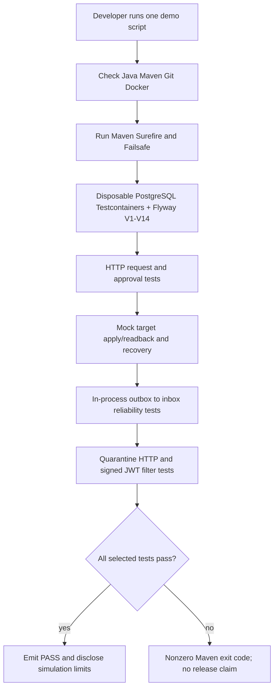

# RC-B — repeatable IAM portfolio demo (no Keycloak password required)

## Purpose

This demonstration is deliberately a **curated, deterministic acceptance-test walkthrough**, not a user-facing web UI or a production deployment. It reuses the existing Spring Boot/PostgreSQL integration tests rather than creating a second authentication service or adding new business features.

The single command `bash ops/demo/run-portfolio-demo.sh` executes a curated suite that shows the request → approval → simulated provisioning → outbox/inbox → quarantine/security boundaries. **Each test class creates its own isolated synthetic fixture:** the stages are a narrated walkthrough of verified functionality, *not* one persistent request ID traveling through every class or an externally deployed system.

## Preflight

- Java 25, Maven 3.9+, Docker Desktop (Docker engine running), Git.
- Docker/Testcontainers can pull `postgres:17-alpine` and run ephemeral PostgreSQL.
- No local `DB_PASSWORD`, Keycloak administrator, browser login, running IAM API, personal data or production identity provider needed.
- The script performs no `docker compose down`, cleanup of operator containers or changes to the user's existing IAM lab database. Testcontainers handles its own container lifecycle.
- Run from any directory; the script selects the repository root.

## Run

```bash
bash ops/demo/run-portfolio-demo.sh
```

The script fails on unavailable prerequisites or any failing Maven test. Output contains a full Maven test summary, immutable commit SHA and an explicit simulation limitation. Its final `PASS` means **only** that the curated suite succeeded; it does not imply every release gate passed.

## Narrated demo stages

| Stage | Existing acceptance test | What it demonstrates | Evidence limitation |
| --- | --- | --- | --- |
| 1. Intake | `AccessRequestPersistenceIT` | Scoped HTTP request creation, idempotent retry, tenant isolation, forbidden bad actors | Uses `spring-security-test` JWT principal in the HTTP tests; synthetic DB fixtures |
| 2. Decision | `ApprovalDecisionHttpIT` | Approval/rejection HTTP, separation of duties, local permissions and audit invariants | Independent test fixture; this is not the same request from Stage 1 |
| 3. Provisioning simulation | `MockProvisioningOrchestratorIT` | Loopback-only apply/readback, retry, unknown state and no blind duplicate writes | Mock target, **not an external entitlement** |
| 4. Reliable delivery | `OutboxInboxEndToEndIT` | Approval -> durable outbox -> explicitly invoked in-process relay -> deduplicated inbox receipt and `RECEIVED` projection | No Kafka/RabbitMQ, no automatic daemon, `RECEIVED` is not GRANTED |
| 5. Quarantine | `QuarantineInspectionHttpIT` | Read-only review of failed simulated work and tenant-/permission-aware access | Fixture deliberately creates repeated failures |
| 6. Security filter | `SignedJwtHttpFilterIT` + `SignedJwtTrustValidationTest` | Signed RS256 JWT checks: invalid signature, issuer, audience, expiry -> 401; insufficient scope/local permission -> 403 | Injects a test-only RSA decoder; no live Keycloak interoperability |

## Operator sequence



Maven and JUnit choose the test execution order; **diagram arrows indicate the presentation order**, not guaranteed JVM execution order or shared database state.

## Evidence capture / troubleshooting

For an auditable manual run, note the `git rev-parse HEAD` value from the script, Maven results and container/image versions. Do not record access tokens, passwords or machine-specific file paths unnecessarily.

- `FAIL: Docker engine unavailable`: start Docker Desktop. Do not remove the pre-existing Keycloak or IAM lab PostgreSQL containers.
- Maven test failure: read `target/surefire-reports` and `target/failsafe-reports` in the local checkout. The script must not report success.
- No need to open port 8082: tests run inside their test application context and mock HTTP layer.
- Existing project `main` or an occupied port 8082 need not be restarted or killed.
- The entire full regression remains `mvn -B --no-transfer-progress clean verify`; the curated demo deliberately does not replace it.

## Acceptance criteria

- [ ] Operator runs `bash ops/demo/run-portfolio-demo.sh`, Maven exits 0 and prints `PASS`.
- [ ] Relevant HTTP and integration test summaries show zero failures/errors.
- [ ] Docker/PostgreSQL Testcontainers start successfully without touching the operator's IAM lab data.
- [ ] Hosted Java and Security CI pass at the PR head.
- [ ] Release register RC-04 records that this is **a staged, isolated-fixture walkthrough**, not a single end-to-end deployed API transaction.
- [ ] No claim of real Keycloak login, deployed broker, live target provisioning or effective entitlement.

## Interview discussion prompts

**Why run multiple focused tests instead of a web demo?** We get repeatable, negative-testable evidence for separate trust and transaction boundaries. The trade-off is a weaker user-journey demonstration; a unified scenario would need a separate test and is not claimed here.

**Why Testcontainers?** Each test class uses disposable PostgreSQL with real Flyway migrations; tests don't depend on the developer's database or identities.

**Why differentiate 401 and 403?** 401 is rejected bearer authentication; 403 can be successfully authenticated but unauthorized. Neither should be interpreted as a successful grant.

**Why can an outbox event be DELIVERED while the user still has no real access?** The event reached the local inbox in this simulation. Delivery and projection are not independent proof that an external application provisioned the entitlement.
