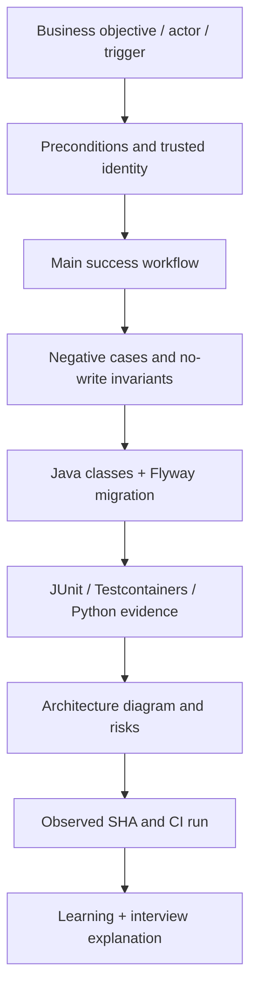

# Enterprise IAM — Use-Case Catalogue (Start Here)

**Read this directory in numeric order after [Learning Lessons 00–02](../learning/README.md).** The original UC-001 source document was an early **design specification**, including future candidate states; the newer UC-002 through UC-010 documents are **as-built scoped acceptance scenarios**, not additional production products or external entitlements.

The published educational portfolio is `v0.1.0-portfolio`. The model includes **one formal primary business workflow** (UC-001) with supporting authorization, governance, reliability, operations and security scenarios. An implemented mock/test path is not a claim of real IAM system integration.

## Numbered use-case sequence

| Use case | Business/technical scenario | Key invariant | Study lesson |
| --- | --- | --- | --- |
| [UC-001](UC-001-application-access-request.md) | Request employee application access | Authorized tenant-local PENDING intent, idempotent retry and denial | 03 |
| [UC-002](UC-002-identity-jwt-and-tenant-authorization.md) | Signed bearer and tenant-local permission | 401 vs 403, actor mapping, scope + local permission | 04 |
| [UC-003](UC-003-approval-rejection-separation-of-duties.md) | Approve or reject with SoD | One decision, requester != approver and terminal state | 06 |
| [UC-004](UC-004-transactional-decision-audit.md) | Audit the approval decision | Same transaction and rollback on audit failure | 06 |
| [UC-005](UC-005-approved-provisioning-intent-and-lease-recovery.md) | Create approved work and recover leases | READY, LEASED, RETRY_WAIT, QUARANTINED; 3 attempts | 07 |
| [UC-006](UC-006-mock-target-apply-readback-reconciliation.md) | Mock target apply/readback | STARTED evidence, stable key, VERIFIED/ABSENT/UNKNOWN | 08 |
| [UC-007](UC-007-quarantine-diagnosis-and-review-evidence.md) | Inspect quarantined work | Readonly, scoped and review evidence without requeue | 09 |
| [UC-008](UC-008-transactional-outbox-retry-delivery.md) | Durable outbox and relay | Atomic event intent, leased delivery and bounded retries | 10 |
| [UC-009](UC-009-transactional-inbox-duplicate-processing.md) | Idempotent inbox and projection | Receipt/RECEIVED transaction and replay control | 10 |
| [UC-010](UC-010-devsecops-regression-and-release-evidence.md) | CI and release evidence governance | Tests, vulnerability/secret/SAST gates, immutable SHA | 11–12 |

**UC-001 addendum:** [Concurrent requests and competing approvals](UC-001-concurrency-and-approval-addendum.md) maps the original A01–A12 requirements to additional Given/When/Then concurrency, SoD and audit rollback scenarios.

## Requirement-to-implementation lifecycle

A use case should answer **who acts, what is authorized, what state changes, what happens on retry/failure, which test proves it, and what is outside scope**.

## Use-case actor and trust map

| Actor | Trusted authority | What cannot be inferred |
| --- | --- | --- |
| Requester | Signed bearer + route scope + active local tenant mapping and CREATE permission | Token/claim alone does not authorize arbitrary request |
| Approver | Separate locally authorized actor with DECIDE permission | Self-approval remains prohibited |
| Quarantine reviewer | Active tenant-local reviewer with read scope/permission | Read-only diagnosis is not remediation |
| Worker/test orchestrator | Current lease token and persisted approval-bound intent | Lease is not an external target permission |
| Inbox consumer | Trusted internal test envelope and unique event receipt | No authenticated production broker listener exists |
| CI reviewer | Exact tested Git SHA, configured workflow checks | Green checks are not certification or deployed proof |

## Acceptance-writing rubric

For future cases, include: **ID + title → business outcome → actor/permission → Given/When/Then → competing/replay/negative scenarios → persistence/transaction invariants → Mermaid diagram → code/migration/test links → observed vs unverified evidence → rollback/operations → interview Q&A.**

Do not add a fictitious UC for deployed SCIM, revocation, JIT access, multi-cloud provisioning or access certification until an implementation and test boundary actually exists; track such capabilities as future requirements separately.

## Start studying

- [Learning curriculum](../learning/README.md)
- [Architecture views](../architecture/README.md)
- [Milestone provenance map](../learning/13-implementation-provenance-and-milestone-map.md)
- [Full engineering guide](../portfolio/complete-engineering-guide.md)
- [Interview workbook](../portfolio/technical-interview-workbook.md)
