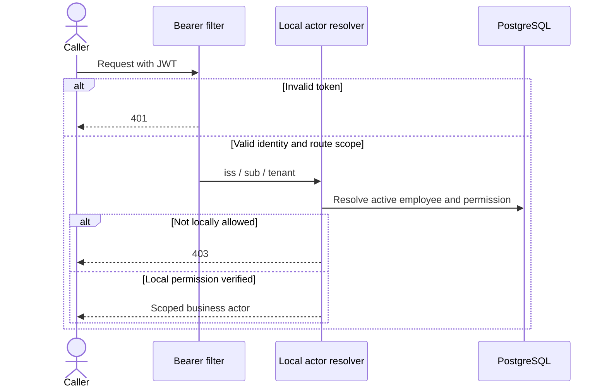

# UC-002 — Verified bearer identity and tenant-local authorization

**Portfolio classification:** implemented controlled local/test scenario, **not** a production entitlement workflow. **Cross-reference:** [learning lesson](../learning/04-spring-security-jwt-and-actor-mapping.md) and [use-case index](README.md). This document specifies the as-built behavior and executable checks; it does not claim a new test execution.

## Purpose, actors and entry conditions

**Business outcome:** Route scope and local actor/resource permission pass; the appropriate business handler may execute without accepting client-provided tenant/requester identity.

**Actors/components:** HTTP client, Spring Security resource-server filter, local IAM actor resolver, PostgreSQL employee/permission records.

**Trigger:** Client requests access-request creation, approval or quarantine inspection.

**Preconditions:** A bearer token is supplied (unless testing anonymous denial). Issuer/audience/time/signature are validated by the configured decoder; the token's subject and tenant claim must map to an active locally permitted employee.

## Main success path — Given / When / Then

**Given** the documented preconditions and a valid tenant-local actor/request or worker context. **When** the verified bearer identity and tenant-local authorization workflow is invoked through its documented interface. **Then** Route scope and local actor/resource permission pass; the appropriate business handler may execute without accepting client-provided tenant/requester identity.

### Step-by-step implementation and acceptance

1. Read the stated business and trust-boundary preconditions; separate user identity from local permission and resource eligibility.
2. Open the source classes listed below; identify public HTTP/controller vs internal-only service or explicit test adapter.
3. Trace persistent invariants through the listed Flyway migration(s); explain what survives process crashes and concurrent writers.
4. Execute or inspect the named test(s) and identify the positive case, failure/no-write case, and transaction scope.
5. Record evidence with exact tested commit, assertion and runner; do not treat synthetic/mock observation as external access.

## Negative / exceptional acceptance scenarios

1. **UC-002-N01 —** No/malformed/untrusted bearer → 401; no business mutation.
2. **UC-002-N02 —** Validly decoded identity without `access:request`, `access:decide` or `provisioning:review` scope → 403.
3. **UC-002-N03 —** Missing/invalid tenant/issuer/subject → fail closed; resolver unit tests assert zero JDBC operations.
4. **UC-002-N04 —** Correct coarse scope but inactive/unmapped/unauthorized employee → 403; cross-tenant resource remains inaccessible.

## Architecture and sequence

Diagram represents the scope of current code and controlled tests. It does not assert a continuously deployed workflow or a live third-party connector.

## Invariants and architectural rationale

- JWT is an authentication boundary; a scope does not grant arbitrary employee permissions.
- Do not derive authenticated tenant/requester from JSON or spoofable headers.
- HTTP MockMvc `jwt()` tests bypass signature verification. Ephemeral RSA HTTP filter tests use a test-only decoder; live Keycloak-issued token acceptance remains unverified.

## Implementation traceability

**Java:**
- [`src/main/java/dev/asambataiden/iam/bootstrap/BootstrapSecurityConfiguration.java`](../../src/main/java/dev/asambataiden/iam/bootstrap/BootstrapSecurityConfiguration.java)
- [`src/main/java/dev/asambataiden/iam/accessrequest/RequestActorResolver.java`](../../src/main/java/dev/asambataiden/iam/accessrequest/RequestActorResolver.java)
- [`src/main/java/dev/asambataiden/iam/accessrequest/DecisionActorResolver.java`](../../src/main/java/dev/asambataiden/iam/accessrequest/DecisionActorResolver.java)
- [`src/main/java/dev/asambataiden/iam/provisioning/quarantine/QuarantineReviewActorResolver.java`](../../src/main/java/dev/asambataiden/iam/provisioning/quarantine/QuarantineReviewActorResolver.java)

**Database migrations:**
- [`src/main/resources/db/migration/V2__bind_idp_subjects_and_permissions.sql`](../../src/main/resources/db/migration/V2__bind_idp_subjects_and_permissions.sql)

**Executable test sources:**
- [`src/test/java/dev/asambataiden/iam/security/ActorResolverInvalidClaimsTest.java`](../../src/test/java/dev/asambataiden/iam/security/ActorResolverInvalidClaimsTest.java)
- [`src/test/java/dev/asambataiden/iam/security/SignedJwtHttpFilterIT.java`](../../src/test/java/dev/asambataiden/iam/security/SignedJwtHttpFilterIT.java)
- [`src/test/java/dev/asambataiden/iam/accessrequest/AccessRequestPersistenceIT.java`](../../src/test/java/dev/asambataiden/iam/accessrequest/AccessRequestPersistenceIT.java)

## Verification and learning exercise

- Start with the focused test identified above; optional full local suite: `mvn -B --no-transfer-progress clean verify` using Docker/Testcontainers.
- Read the specific negative assertion; explain whether failure is caused by HTTP authentication, local policy, relational constraint, row lock, or transaction rollback.
- Re-draw the sequence and identify the failure window. Do not change migrations or production code to perform a documentation exercise.
- Explain to an interviewer: **what requirement, why this design, how implemented, what test proves it, what remains unproven.**

**Release qualification:** The published `v0.1.0-portfolio` tests are documented in [release evidence](../release/evidence-register.md); newer documentation changes do not retest themselves. No live Keycloak interoperability, broker durability, external entitlement or production readiness is inferred.