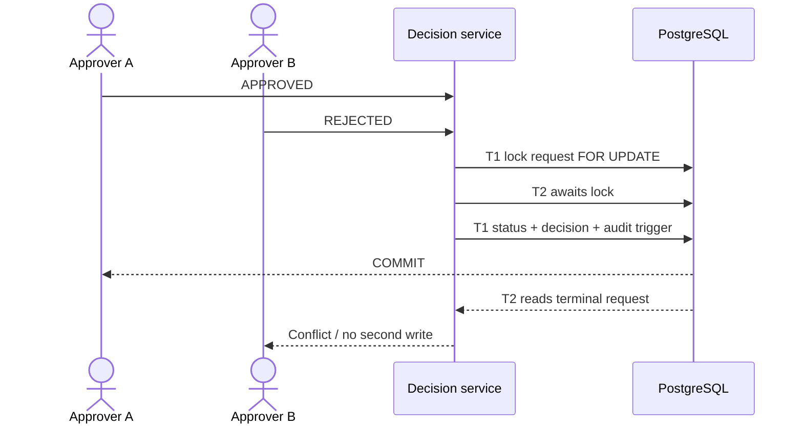

# UC-003 — Tenant-bound approval, rejection and separation of duties

**Portfolio classification:** implemented controlled local/test scenario, **not** a production entitlement workflow. **Cross-reference:** [learning lesson](../learning/06-approval-sod-and-transactional-audit.md) and [use-case index](README.md). This document specifies the as-built behavior and executable checks; it does not claim a new test execution.

## Purpose, actors and entry conditions

**Business outcome:** One legal terminal transition and one persisted `access_decisions` row. V4 audit evidence commits in same transaction. APPROVED creates separate work/outbox intent; REJECTED does not.

**Actors/components:** Distinct tenant approver, original requester, ApprovalDecisionController/Resolver/Service and PostgreSQL.

**Trigger:** Authorized approver submits APPROVED or REJECTED for one PENDING request.

**Preconditions:** Approver is ACTIVE, maps from verified JWT claims, has `SCOPE_access:decide` and local `ACCESS_REQUEST_DECIDE`, same-tenant request remains PENDING.

## Main success path — Given / When / Then

**Given** the documented preconditions and a valid tenant-local actor/request or worker context. **When** the tenant-bound approval, rejection and separation of duties workflow is invoked through its documented interface. **Then** One legal terminal transition and one persisted `access_decisions` row. V4 audit evidence commits in same transaction. APPROVED creates separate work/outbox intent; REJECTED does not.

### Step-by-step implementation and acceptance

1. Read the stated business and trust-boundary preconditions; separate user identity from local permission and resource eligibility.
2. Open the source classes listed below; identify public HTTP/controller vs internal-only service or explicit test adapter.
3. Trace persistent invariants through the listed Flyway migration(s); explain what survives process crashes and concurrent writers.
4. Execute or inspect the named test(s) and identify the positive case, failure/no-write case, and transaction scope.
5. Record evidence with exact tested commit, assertion and runner; do not treat synthetic/mock observation as external access.

## Negative / exceptional acceptance scenarios

1. **UC-003-N01 —** Requester approving own request → denied, no mutation even if permission is present.
2. **UC-003-N02 —** Foreign tenant or inactive approver/subject/application → denied or unavailable without cross-tenant leakage.
3. **UC-003-N03 —** Two opposing decisions race → exactly one winner; other sees terminal state/conflict.
4. **UC-003-N04 —** Repeated decision after APPROVED/REJECTED → conflict; no additional evidence.
5. **UC-003-N05 —** Audit insertion failure → status, decision, work and outbox intent roll back together.

## Architecture and sequence

Diagram represents the scope of current code and controlled tests. It does not assert a continuously deployed workflow or a live third-party connector.

## Invariants and architectural rationale

- Use persisted requester and V3 SoD CHECK/FK, not caller-provided request ownership.
- `SELECT ... FOR UPDATE OF ar` and transactional PENDING guard serialize decision races.
- APPROVED means governance authorization, not effective external entitlement.

## Implementation traceability

**Java:**
- [`src/main/java/dev/asambataiden/iam/accessrequest/ApprovalDecisionController.java`](../../src/main/java/dev/asambataiden/iam/accessrequest/ApprovalDecisionController.java)
- [`src/main/java/dev/asambataiden/iam/accessrequest/ApprovalDecisionService.java`](../../src/main/java/dev/asambataiden/iam/accessrequest/ApprovalDecisionService.java)

**Database migrations:**
- [`src/main/resources/db/migration/V3__approval_decision_foundation.sql`](../../src/main/resources/db/migration/V3__approval_decision_foundation.sql)
- [`src/main/resources/db/migration/V4__approval_transactional_audit.sql`](../../src/main/resources/db/migration/V4__approval_transactional_audit.sql)

**Executable test sources:**
- [`src/test/java/dev/asambataiden/iam/accessrequest/ApprovalDecisionServiceIT.java`](../../src/test/java/dev/asambataiden/iam/accessrequest/ApprovalDecisionServiceIT.java)
- [`src/test/java/dev/asambataiden/iam/accessrequest/ApprovalDecisionHttpIT.java`](../../src/test/java/dev/asambataiden/iam/accessrequest/ApprovalDecisionHttpIT.java)

## Verification and learning exercise

- Start with the focused test identified above; optional full local suite: `mvn -B --no-transfer-progress clean verify` using Docker/Testcontainers.
- Read the specific negative assertion; explain whether failure is caused by HTTP authentication, local policy, relational constraint, row lock, or transaction rollback.
- Re-draw the sequence and identify the failure window. Do not change migrations or production code to perform a documentation exercise.
- Explain to an interviewer: **what requirement, why this design, how implemented, what test proves it, what remains unproven.**

**Release qualification:** The published `v0.1.0-portfolio` tests are documented in [release evidence](../release/evidence-register.md); newer documentation changes do not retest themselves. No live Keycloak interoperability, broker durability, external entitlement or production readiness is inferred.