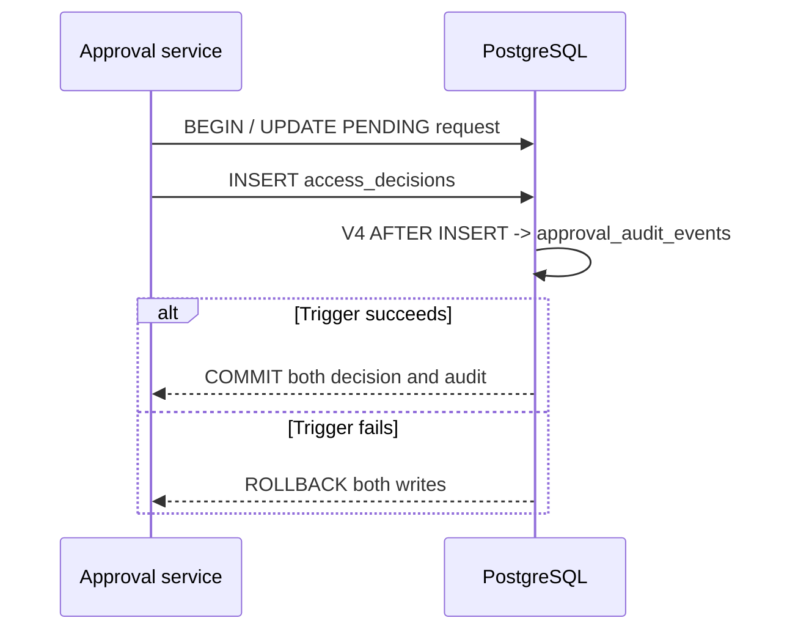

# UC-004 — Persisting audit evidence in the approval transaction

**Portfolio classification:** implemented controlled local/test scenario, **not** a production entitlement workflow. **Cross-reference:** [learning lesson](../learning/06-approval-sod-and-transactional-audit.md) and [use-case index](README.md). This document specifies the as-built behavior and executable checks; it does not claim a new test execution.

## Purpose, actors and entry conditions

**Business outcome:** V4 `AFTER INSERT` creates matching approval audit record with tenant/request/requester/approver/outcome/timestamp; approval and audit commit together.

**Actors/components:** Approver, ApprovalDecisionService, PostgreSQL V4 trigger and downstream approved-work triggers.

**Trigger:** The application inserts one valid `access_decisions` row.

**Preconditions:** A valid pending decision is being committed under `@Transactional`; all required FK/SoD rules are satisfied.

## Main success path — Given / When / Then

**Given** the documented preconditions and a valid tenant-local actor/request or worker context. **When** the persisting audit evidence in the approval transaction workflow is invoked through its documented interface. **Then** V4 `AFTER INSERT` creates matching approval audit record with tenant/request/requester/approver/outcome/timestamp; approval and audit commit together.

### Step-by-step implementation and acceptance

1. Read the stated business and trust-boundary preconditions; separate user identity from local permission and resource eligibility.
2. Open the source classes listed below; identify public HTTP/controller vs internal-only service or explicit test adapter.
3. Trace persistent invariants through the listed Flyway migration(s); explain what survives process crashes and concurrent writers.
4. Execute or inspect the named test(s) and identify the positive case, failure/no-write case, and transaction scope.
5. Record evidence with exact tested commit, assertion and runner; do not treat synthetic/mock observation as external access.

## Negative / exceptional acceptance scenarios

1. **UC-004-N01 —** Audit uniqueness conflict or forced insertion failure → entire transaction rolls back.
2. **UC-004-N02 —** Ordinary UPDATE/DELETE on audit record → rejected by V4 trigger.
3. **UC-004-N03 —** Denied/self-approval/replayed terminal decision → no second audit record.
4. **UC-004-N04 —** Privileged database owner can bypass triggers → not WORM or externally certified immutable evidence.

## Architecture and sequence

Diagram represents the scope of current code and controlled tests. It does not assert a continuously deployed workflow or a live third-party connector.

## Invariants and architectural rationale

- Audit event must correlate with original committed decision and not leak JWTs, passwords or entire request payloads.
- Database triggers enforce coupled writes for any normal SQL decision writer; operational privileged access still demands controls.
- No production SIEM integration, audit-retention program or tamper-proof storage is claimed.

## Implementation traceability

**Java:**
- [`src/main/java/dev/asambataiden/iam/accessrequest/ApprovalDecisionService.java`](../../src/main/java/dev/asambataiden/iam/accessrequest/ApprovalDecisionService.java)

**Database migrations:**
- [`src/main/resources/db/migration/V4__approval_transactional_audit.sql`](../../src/main/resources/db/migration/V4__approval_transactional_audit.sql)

**Executable test sources:**
- [`src/test/java/dev/asambataiden/iam/accessrequest/ApprovalDecisionServiceIT.java`](../../src/test/java/dev/asambataiden/iam/accessrequest/ApprovalDecisionServiceIT.java)

## Verification and learning exercise

- Start with the focused test identified above; optional full local suite: `mvn -B --no-transfer-progress clean verify` using Docker/Testcontainers.
- Read the specific negative assertion; explain whether failure is caused by HTTP authentication, local policy, relational constraint, row lock, or transaction rollback.
- Re-draw the sequence and identify the failure window. Do not change migrations or production code to perform a documentation exercise.
- Explain to an interviewer: **what requirement, why this design, how implemented, what test proves it, what remains unproven.**

**Release qualification:** The published `v0.1.0-portfolio` tests are documented in [release evidence](../release/evidence-register.md); newer documentation changes do not retest themselves. No live Keycloak interoperability, broker durability, external entitlement or production readiness is inferred.