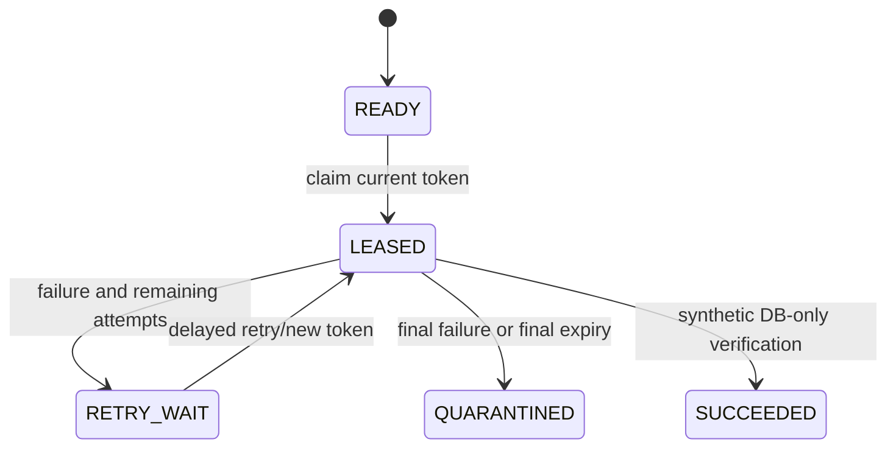

# UC-005 — Approved provisioning work and lease-fenced retry

**Portfolio classification:** implemented controlled local/test scenario, **not** a production entitlement workflow. **Cross-reference:** [learning lesson](../learning/07-provisioning-intent-leases-and-fencing.md) and [use-case index](README.md). This document specifies the as-built behavior and executable checks; it does not claim a new test execution.

## Purpose, actors and entry conditions

**Business outcome:** Single worker claims with new UUID fencing token and DB-time expiry; controlled renew/failure leads to RETRY_WAIT or QUARANTINED. Simulation only.

**Actors/components:** Approval transaction, provisioning lease service, worker simulation, PostgreSQL.

**Trigger:** An APPROVED decision commits and creates a READY provisioning work item.

**Preconditions:** Approved decision exists for tenant/request; work record is eligible, not already actively leased, and below the three-attempt limit.

## Main success path — Given / When / Then

**Given** the documented preconditions and a valid tenant-local actor/request or worker context. **When** the approved provisioning work and lease-fenced retry workflow is invoked through its documented interface. **Then** Single worker claims with new UUID fencing token and DB-time expiry; controlled renew/failure leads to RETRY_WAIT or QUARANTINED. Simulation only.

### Step-by-step implementation and acceptance

1. Read the stated business and trust-boundary preconditions; separate user identity from local permission and resource eligibility.
2. Open the source classes listed below; identify public HTTP/controller vs internal-only service or explicit test adapter.
3. Trace persistent invariants through the listed Flyway migration(s); explain what survives process crashes and concurrent writers.
4. Execute or inspect the named test(s) and identify the positive case, failure/no-write case, and transaction scope.
5. Record evidence with exact tested commit, assertion and runner; do not treat synthetic/mock observation as external access.

## Negative / exceptional acceptance scenarios

1. **UC-005-N01 —** Rejected/unapproved request → cannot create claimable work.
2. **UC-005-N02 —** Competing claimers → no duplicate active lease.
3. **UC-005-N03 —** Expired token after another worker recovers → stale update rejected.
4. **UC-005-N04 —** Three failures or expired final-attempt lease → QUARANTINED, not unbounded retry.
5. **UC-005-N05 —** Simulated SUCCEEDED without matching synthetic entitlement and current lease → rejected.

## Architecture and sequence

Diagram represents the scope of current code and controlled tests. It does not assert a continuously deployed workflow or a live third-party connector.

## Invariants and architectural rationale

- Claim uses `FOR UPDATE SKIP LOCKED`; `renew`/`fail` check token and expiry in SQL.
- Attempts increment on claim, including worker crash; allowlisted error codes avoid secrets in durable state.
- No automatic daemon, production target API or real access grant.

## Implementation traceability

**Java:**
- [`src/main/java/dev/asambataiden/iam/provisioning/execution/ProvisioningLeaseService.java`](../../src/main/java/dev/asambataiden/iam/provisioning/execution/ProvisioningLeaseService.java)
- [`src/main/java/dev/asambataiden/iam/provisioning/execution/SimulatedProvisioningService.java`](../../src/main/java/dev/asambataiden/iam/provisioning/execution/SimulatedProvisioningService.java)

**Database migrations:**
- [`src/main/resources/db/migration/V5__approved_provisioning_work_items.sql`](../../src/main/resources/db/migration/V5__approved_provisioning_work_items.sql)
- [`src/main/resources/db/migration/V6__provisioning_lease_state.sql`](../../src/main/resources/db/migration/V6__provisioning_lease_state.sql)
- [`src/main/resources/db/migration/V7__simulated_provisioning_verification.sql`](../../src/main/resources/db/migration/V7__simulated_provisioning_verification.sql)

**Executable test sources:**
- [`src/test/java/dev/asambataiden/iam/provisioning/execution/ProvisioningLeaseServiceIT.java`](../../src/test/java/dev/asambataiden/iam/provisioning/execution/ProvisioningLeaseServiceIT.java)
- [`src/test/java/dev/asambataiden/iam/provisioning/execution/SimulatedProvisioningServiceIT.java`](../../src/test/java/dev/asambataiden/iam/provisioning/execution/SimulatedProvisioningServiceIT.java)

## Verification and learning exercise

- Start with the focused test identified above; optional full local suite: `mvn -B --no-transfer-progress clean verify` using Docker/Testcontainers.
- Read the specific negative assertion; explain whether failure is caused by HTTP authentication, local policy, relational constraint, row lock, or transaction rollback.
- Re-draw the sequence and identify the failure window. Do not change migrations or production code to perform a documentation exercise.
- Explain to an interviewer: **what requirement, why this design, how implemented, what test proves it, what remains unproven.**

**Release qualification:** The published `v0.1.0-portfolio` tests are documented in [release evidence](../release/evidence-register.md); newer documentation changes do not retest themselves. No live Keycloak interoperability, broker durability, external entitlement or production readiness is inferred.