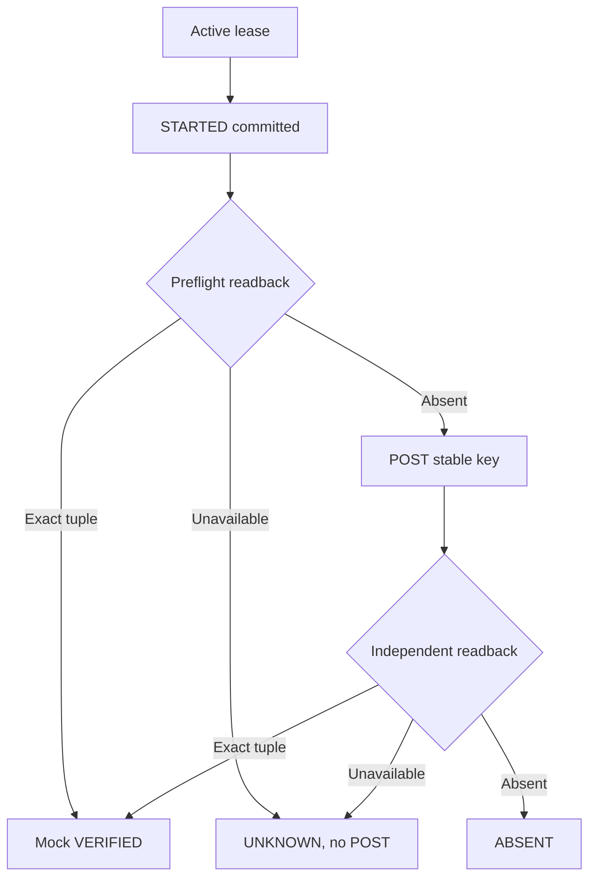

# UC-006 — Safe mock target apply, readback and uncertain outcomes

**Portfolio classification:** implemented controlled local/test scenario, **not** a production entitlement workflow. **Cross-reference:** [learning lesson](../learning/08-adapter-contract-mock-http-reconciliation.md) and [use-case index](README.md). This document specifies the as-built behavior and executable checks; it does not claim a new test execution.

## Purpose, actors and entry conditions

**Business outcome:** Independent preflight readback finds exact tuple or POST uses stable idempotency key; independent readback records mock VERIFIED or ABSENT/UNKNOWN.

**Actors/components:** Explicit test orchestrator, attempt journal, loopback-only target adapter, local mock HTTP server, observation journal.

**Trigger:** A current worker lease initiates a simulated target operation on an approved request.

**Preconditions:** Valid current unexpired lease; approved tenant-local employee/application/role; STARTED attempt journal commits before network call.

## Main success path — Given / When / Then

**Given** the documented preconditions and a valid tenant-local actor/request or worker context. **When** the safe mock target apply, readback and uncertain outcomes workflow is invoked through its documented interface. **Then** Independent preflight readback finds exact tuple or POST uses stable idempotency key; independent readback records mock VERIFIED or ABSENT/UNKNOWN.

### Step-by-step implementation and acceptance

1. Read the stated business and trust-boundary preconditions; separate user identity from local permission and resource eligibility.
2. Open the source classes listed below; identify public HTTP/controller vs internal-only service or explicit test adapter.
3. Trace persistent invariants through the listed Flyway migration(s); explain what survives process crashes and concurrent writers.
4. Execute or inspect the named test(s) and identify the positive case, failure/no-write case, and transaction scope.
5. Record evidence with exact tested commit, assertion and runner; do not treat synthetic/mock observation as external access.

## Negative / exceptional acceptance scenarios

1. **UC-006-N01 —** Preflight readback unavailable → UNKNOWN, no speculative POST.
2. **UC-006-N02 —** POST accepted but ACK lost → re-read target; exact observed tuple can be VERIFIED without duplicate blind write.
3. **UC-006-N03 —** Wrong tuple, redirect, remote address or invalid lease → rejected/not verified.
4. **UC-006-N04 —** Observation after lease recovery using stale token → rejected.
5. **UC-006-N05 —** Mock VERIFIED does not mean any real application has granted access.

## Architecture and sequence

Diagram represents the scope of current code and controlled tests. It does not assert a continuously deployed workflow or a live third-party connector.

## Invariants and architectural rationale

- Stable idempotency key is based on tenant/request and survives lease rotation.
- Only loopback HTTP development adapter, timeouts, no redirect, explicitly constructed orchestrator.
- Write-ahead STARTED does not prove the remote POST happened or succeeded.

## Implementation traceability

**Java:**
- [`src/main/java/dev/asambataiden/iam/provisioning/execution/MockProvisioningOrchestrator.java`](../../src/main/java/dev/asambataiden/iam/provisioning/execution/MockProvisioningOrchestrator.java)
- [`src/main/java/dev/asambataiden/iam/provisioning/target/LoopbackHttpProvisioningTargetAdapter.java`](../../src/main/java/dev/asambataiden/iam/provisioning/target/LoopbackHttpProvisioningTargetAdapter.java)

**Database migrations:**
- [`src/main/resources/db/migration/V8__provisioning_attempt_evidence.sql`](../../src/main/resources/db/migration/V8__provisioning_attempt_evidence.sql)
- [`src/main/resources/db/migration/V9__mock_target_observations.sql`](../../src/main/resources/db/migration/V9__mock_target_observations.sql)

**Executable test sources:**
- [`src/test/java/dev/asambataiden/iam/provisioning/execution/MockProvisioningOrchestratorIT.java`](../../src/test/java/dev/asambataiden/iam/provisioning/execution/MockProvisioningOrchestratorIT.java)
- [`src/test/java/dev/asambataiden/iam/provisioning/target/LoopbackHttpProvisioningTargetAdapterTest.java`](../../src/test/java/dev/asambataiden/iam/provisioning/target/LoopbackHttpProvisioningTargetAdapterTest.java)

## Verification and learning exercise

- Start with the focused test identified above; optional full local suite: `mvn -B --no-transfer-progress clean verify` using Docker/Testcontainers.
- Read the specific negative assertion; explain whether failure is caused by HTTP authentication, local policy, relational constraint, row lock, or transaction rollback.
- Re-draw the sequence and identify the failure window. Do not change migrations or production code to perform a documentation exercise.
- Explain to an interviewer: **what requirement, why this design, how implemented, what test proves it, what remains unproven.**

**Release qualification:** The published `v0.1.0-portfolio` tests are documented in [release evidence](../release/evidence-register.md); newer documentation changes do not retest themselves. No live Keycloak interoperability, broker durability, external entitlement or production readiness is inferred.