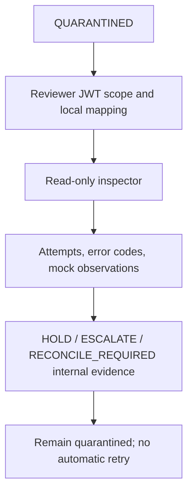

# UC-007 — Read-only quarantine diagnosis and structured review evidence

**As-built acceptance scenario · educational portfolio scope.** This describes verified implementation/test intent from the existing repository; it is not a new production capability. [Use-case index](README.md) · [Learning lesson](../learning/09-quarantine-inspection-and-review-evidence.md).

## Business outcome and actors

**Actors/components:** Authorized quarantine reviewer, `QuarantineInspectionController`, `QuarantineReviewActorResolver`, recovery inspector, internal review journal.

**Trigger:** A simulated work item has entered QUARANTINED after exhausted execution attempts or final lease expiry.

**Preconditions:** For HTTP inspection, valid bearer with provisioning:review scope plus tenant-local active authorized employee. For the internal review journal, tenant-local active reviewer UUID; internal method alone is not proof of authentication.

**Successful result:** Read-only, bounded tenant-local snapshot exposes work state, attempts, error and mock observations; a separate internal journal may record HOLD, ESCALATE or RECONCILE_REQUIRED without changing work, leases or targets.

## Main path — Given / When / Then

**Given** valid preconditions and a correctly scoped internal or HTTP caller, **when** this workflow is invoked, **then** Read-only, bounded tenant-local snapshot exposes work state, attempts, error and mock observations; a separate internal journal may record HOLD, ESCALATE or RECONCILE_REQUIRED without changing work, leases or targets.

### Step-by-step implementation reasoning

1. Establish the trust boundary and input that must never be accepted as unverified authority.
2. Trace the Java entry point and distinguish HTTP-authenticated controllers from internal-only or explicit test collaborators.
3. Trace the persistence rules/migration and identify the transaction/lease/event identity that makes a retry safe.
4. Inspect the existing tests, including at least one rejection, race or rollback scenario.
5. Distinguish the recorded test evidence and mocked actors from any live IdP/broker/third-party claim.

## Negative acceptance and recovery

1. **UC-007-N01** — Anonymous/malformed JWT or missing scope → deny inspection.
2. **UC-007-N02** — Wrong-tenant/unmapped/disabled reviewer → deny or conceal resource; never return another tenant's snapshots.
3. **UC-007-N03** — GET list limit outside 1–100 → reject request.
4. **UC-007-N04** — Review ID reused with conflicting content → reject, preserving earlier review.
5. **UC-007-N05** — Recording review must not requeue the work, retry a target, alter attempts or grant access.

## Architectural flow

Diagram shows implemented contract or controlled test flow; it does not imply a deployed production service or external entitlement.

## Invariants and trade-offs

- No public POST review/remediation endpoint exists; authenticated HTTP inspection is read-only.
- A review record is structured evidence, not privileged operational authorization, and no WORM guarantee exists.
- An uncertain target outcome must be independently reconciled before any future requeue decision.

## Traceability: code, data, tests

**Source**
- [`src/main/java/dev/asambataiden/iam/provisioning/quarantine/QuarantineInspectionController.java`](../../src/main/java/dev/asambataiden/iam/provisioning/quarantine/QuarantineInspectionController.java)
- [`src/main/java/dev/asambataiden/iam/provisioning/quarantine/ProvisioningRecoveryInspector.java`](../../src/main/java/dev/asambataiden/iam/provisioning/quarantine/ProvisioningRecoveryInspector.java)
- [`src/main/java/dev/asambataiden/iam/provisioning/quarantine/QuarantineReviewJournal.java`](../../src/main/java/dev/asambataiden/iam/provisioning/quarantine/QuarantineReviewJournal.java)

**Database / related persistence**
- [`src/main/resources/db/migration/V10__quarantine_review_evidence.sql`](../../src/main/resources/db/migration/V10__quarantine_review_evidence.sql)
- [`src/main/resources/db/migration/V11__quarantine_review_permission.sql`](../../src/main/resources/db/migration/V11__quarantine_review_permission.sql)

**Existing executable tests and validators**
- [`src/test/java/dev/asambataiden/iam/provisioning/quarantine/QuarantineInspectionHttpIT.java`](../../src/test/java/dev/asambataiden/iam/provisioning/quarantine/QuarantineInspectionHttpIT.java)
- [`src/test/java/dev/asambataiden/iam/provisioning/quarantine/QuarantineReviewJournalIT.java`](../../src/test/java/dev/asambataiden/iam/provisioning/quarantine/QuarantineReviewJournalIT.java)

## Review, reproduction and interview questions

- Run only the relevant existing tests or validators from this list; record the exact current commit, command and result. For the entire Java suite: `mvn -B --no-transfer-progress clean verify` with Docker.
- Explain which failure could occur **after** a database commit or outside an authenticated boundary.
- Identify the invariant that should survive a crash or retry; explain how to confirm no unauthorized state change.
- Name one production gap and its acceptance criterion before designing a real integration.

**Evidence/limits:** release results are tied to `v0.1.0-portfolio` commit `cf0e2fce324fa6c81bf5bccc4ee49dadf1925391`; documentation commits do not retroactively change those tests. There is no verified live Keycloak bearer interoperability, production broker or third-party entitlement provisioning.