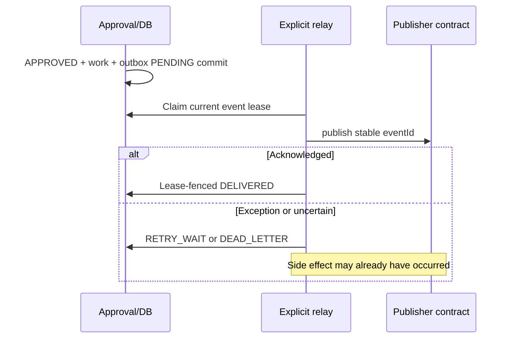

# UC-008 — Atomic outbox intent and lease-fenced at-least-once event relay

**As-built acceptance scenario · educational portfolio scope.** This describes verified implementation/test intent from the existing repository; it is not a new production capability. [Use-case index](README.md) · [Learning lesson](../learning/10-transactional-outbox-relay-and-inbox.md).

## Business outcome and actors

**Actors/components:** Approval transaction and V12 trigger, outbox delivery service, explicit outbox relay, in-process test publisher.

**Trigger:** Approved provisioning work item commits and an outbox event becomes eligible for delivery.

**Preconditions:** V12 stable outbox event exists; V13 lease and retry state is valid; relay is explicitly invoked by a controlled test caller (no automatic broker/scheduler).

**Successful result:** Claim one eligible event with lease, invoke publisher outside DB transaction, record fenced DELIVERED on acknowledgement; retry with same immutable event ID on uncertain error.

## Main path — Given / When / Then

**Given** valid preconditions and a correctly scoped internal or HTTP caller, **when** this workflow is invoked, **then** Claim one eligible event with lease, invoke publisher outside DB transaction, record fenced DELIVERED on acknowledgement; retry with same immutable event ID on uncertain error.

### Step-by-step implementation reasoning

1. Establish the trust boundary and input that must never be accepted as unverified authority.
2. Trace the Java entry point and distinguish HTTP-authenticated controllers from internal-only or explicit test collaborators.
3. Trace the persistence rules/migration and identify the transaction/lease/event identity that makes a retry safe.
4. Inspect the existing tests, including at least one rejection, race or rollback scenario.
5. Distinguish the recorded test evidence and mocked actors from any live IdP/broker/third-party claim.

## Negative acceptance and recovery

1. **UC-008-N01** — Rejected or rolled-back approval → no outbox event.
2. **UC-008-N02** — Two concurrent relay claims → no duplicate active lease ownership.
3. **UC-008-N03** — Publisher exception after an actual consumer side effect → event may retry; duplicate is permitted.
4. **UC-008-N04** — Expired/stale lease cannot record DELIVERED after a successor takes ownership.
5. **UC-008-N05** — Five failed delivery attempts can lead to DEAD_LETTER; no automatic requeue or production alerting.

## Architectural flow

Diagram shows implemented contract or controlled test flow; it does not imply a deployed production service or external entitlement.

## Invariants and trade-offs

- Approved business state and outbox PENDING insert are one local DB commit, not a broker send.
- `publisher.publish` occurs outside JDBC transaction; at-least-once semantics are unavoidable without broader guarantees.
- No Kafka/RabbitMQ broker or network listener is present; in-process publisher is a test adapter.

## Traceability: code, data, tests

**Source**
- [`src/main/java/dev/asambataiden/iam/provisioning/outbox/OutboxRelay.java`](../../src/main/java/dev/asambataiden/iam/provisioning/outbox/OutboxRelay.java)
- [`src/main/java/dev/asambataiden/iam/provisioning/outbox/OutboxDeliveryService.java`](../../src/main/java/dev/asambataiden/iam/provisioning/outbox/OutboxDeliveryService.java)

**Database / related persistence**
- [`src/main/resources/db/migration/V12__provisioning_transactional_outbox.sql`](../../src/main/resources/db/migration/V12__provisioning_transactional_outbox.sql)
- [`src/main/resources/db/migration/V13__outbox_delivery_leases.sql`](../../src/main/resources/db/migration/V13__outbox_delivery_leases.sql)

**Existing executable tests and validators**
- [`src/test/java/dev/asambataiden/iam/provisioning/outbox/ProvisioningTransactionalOutboxIT.java`](../../src/test/java/dev/asambataiden/iam/provisioning/outbox/ProvisioningTransactionalOutboxIT.java)
- [`src/test/java/dev/asambataiden/iam/provisioning/outbox/OutboxRelayIT.java`](../../src/test/java/dev/asambataiden/iam/provisioning/outbox/OutboxRelayIT.java)

## Review, reproduction and interview questions

- Run only the relevant existing tests or validators from this list; record the exact current commit, command and result. For the entire Java suite: `mvn -B --no-transfer-progress clean verify` with Docker.
- Explain which failure could occur **after** a database commit or outside an authenticated boundary.
- Identify the invariant that should survive a crash or retry; explain how to confirm no unauthorized state change.
- Name one production gap and its acceptance criterion before designing a real integration.

**Evidence/limits:** release results are tied to `v0.1.0-portfolio` commit `cf0e2fce324fa6c81bf5bccc4ee49dadf1925391`; documentation commits do not retroactively change those tests. There is no verified live Keycloak bearer interoperability, production broker or third-party entitlement provisioning.