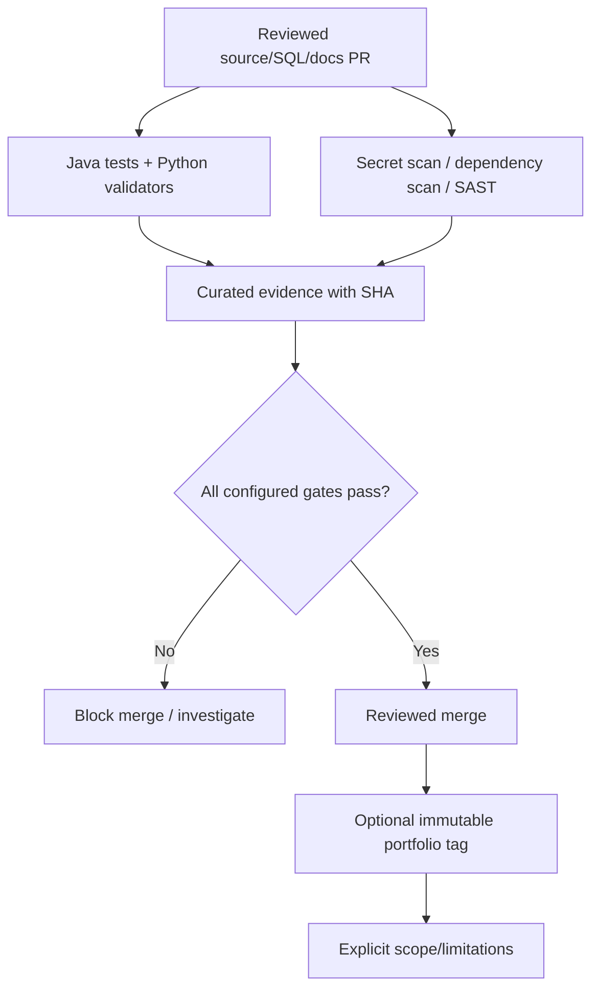

# UC-010 — Secure change validation, reproducible CI and bounded portfolio release

**As-built acceptance scenario · educational portfolio scope.** This describes verified implementation/test intent from the existing repository; it is not a new production capability. [Use-case index](README.md) · [Learning lesson](../learning/11-testing-devsecops-supply-chain-and-evidence.md).

## Business outcome and actors

**Actors/components:** Developer, PR reviewer, GitHub Java CI and Security CI, evidence-manifest generator.

**Trigger:** A change enters PR review, merges into main or is evaluated for publication as a tagged portfolio release.

**Preconditions:** Review branch with changes and dependency/tool versions; configured CI workflows, GitHub permissions and evidence scripts are in place.

**Successful result:** JUnit/Python and configured Gitleaks, Trivy, SpotBugs/Find Security Bugs checks pass at a specified SHA; curated evidence records tested run/attempt; educational release claims use that immutable commit only.

## Main path — Given / When / Then

**Given** a developer has opened a pull request or pushed a reviewed change, **when** the GitHub Actions workflows execute against that exact tested Git ref, **then**:

1. Java CI configures Java 25, validates helper assets and Python tests, runs Maven Surefire/Failsafe with Testcontainers, and generates a curated Java evidence manifest on successful validation.
2. Security CI runs Gitleaks secret detection, Trivy vulnerability scanning and SpotBugs/Find Security Bugs with the unresolved-reference regression guard.
3. The configured workflow action references are verified against the pinned SHA inventory; read-only permissions and non-persistent checkout credentials limit workflow access.
4. Successful jobs yield run- and commit-specific evidence; failed or empty test/SAST reports must not produce a false positive success manifest.
5. A reviewer uses actual job status, tested SHA and documented coverage limits to decide whether to merge; publication of an educational Git tag is a **separate** owner action after merged-main validation.

This is a CI governance scenario; it has **no HTTP actor, entitlement request, Java REST controller or database transaction of its own**.

### Step-by-step source review

1. Open `.github/workflows/java-ci.yml` and `.github/workflows/security-ci.yml`; identify triggers, jobs, minimal repository permissions and the actual commands.
2. Review `config/github-actions-pins.json` and `ops/security/verify_github_actions_pins.py`; demonstrate the difference between immutable commit refs and mutable tags within the supported parser scope.
3. Inspect `pom.xml`, `config/spotbugs-exclude.xml`, and `ops/security/verify_spotbugs_coverage.py`; explain why a green SAST check is still subject to documented exclusions and unresolved reference names.
4. Inspect `ops/security/create_ci_evidence.py` and its tests: understand report parsing, SHA-256 digests, run attempt identity, refusal of empty/failed suites, and why raw logs/XML are not uploaded.
5. For the published educational release compare the tag SHA against the exact [final push CI and local regression evidence](../release/evidence-register.md). Do **not** attribute CI results from an earlier PR head to a different merged commit.

## Negative acceptance and recovery

1. **UC-010-N01** — Secret-like content detected in Git history → investigate and fail; don't disable scan.
2. **UC-010-N02** — Configured HIGH/CRITICAL dependency vulnerability → Trivy gate fails.
3. **UC-010-N03** — Unexcluded SAST finding, new unresolved analyzer name or invalid report → security gate fails.
4. **UC-010-N04** — Empty/failed test reports → evidence generator must not publish success.
5. **UC-010-N05** — Unreviewed mutable GitHub Action tag → pin-policy check fails within inventoried workflows.
6. **UC-010-N06** — Tag/branch points at a different SHA → older check result is not evidence of that new commit.

## Architectural flow

Diagram shows implemented contract or controlled test flow; it does not imply a deployed production service or external entitlement.

## Invariants and trade-offs

- Read-only GitHub token, pinned third-party workflow action SHAs and reviewed exceptions reduce supply-chain risk.
- Curated JSON manifests contain digests and run identity but are not signed attestations or complete audit archives.
- Passing security jobs does not prove runtime secrets rotation, penetration testing, production IAM compliance or full SAST coverage.

## Traceability: code, data, tests

**Source**
- [`ops/security/create_ci_evidence.py`](../../ops/security/create_ci_evidence.py)
- [`ops/security/verify_github_actions_pins.py`](../../ops/security/verify_github_actions_pins.py)
- [`ops/security/verify_spotbugs_coverage.py`](../../ops/security/verify_spotbugs_coverage.py)

**Workflow and configuration**
- [`.github/workflows/java-ci.yml`](../../.github/workflows/java-ci.yml)
- [`.github/workflows/security-ci.yml`](../../.github/workflows/security-ci.yml)
- [`config/github-actions-pins.json`](../../config/github-actions-pins.json)
- [`config/spotbugs-exclude.xml`](../../config/spotbugs-exclude.xml)

**Database migration:** Not applicable to this CI use case. Flyway V1–V14 are verified as part of Java integration tests, but UC-010 introduces no additional schema migration.

**Existing executable tests and validators**
- [`ops/security/test_create_ci_evidence.py`](../../ops/security/test_create_ci_evidence.py)
- [`ops/security/test_verify_github_actions_pins.py`](../../ops/security/test_verify_github_actions_pins.py)
- [`ops/security/test_verify_spotbugs_coverage.py`](../../ops/security/test_verify_spotbugs_coverage.py)

## Review, reproduction and interview questions

- Run only the relevant existing tests or validators from this list; record the exact current commit, command and result. For the entire Java suite: `mvn -B --no-transfer-progress clean verify` with Docker.
- Explain what happens when a scanner cannot retrieve its vulnerability database, a job is retried, a test report is empty, or a PR head differs from its synthetic merge SHA.
- Identify which evidence artifacts are uploaded, their retention policy, and what they do **not** attest.
- Name one production gap and its acceptance criterion before designing a real integration.

**Evidence/limits:** release results are tied to `v0.1.0-portfolio` commit `cf0e2fce324fa6c81bf5bccc4ee49dadf1925391`; documentation commits do not retroactively change those tests. There is no verified live Keycloak bearer interoperability, production broker or third-party entitlement provisioning.