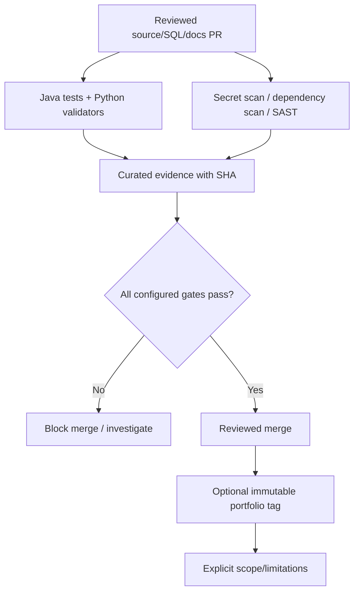

# UC-010 — Secure change validation, reproducible CI and bounded portfolio release

**As-built acceptance scenario · educational portfolio scope.** This describes verified implementation/test intent from the existing repository; it is not a new production capability. [Use-case index](README.md) · [Learning lesson](../learning/11-testing-devsecops-supply-chain-and-evidence.md).

## Business outcome and actors

**Actors/components:** Developer, PR reviewer, GitHub Java CI and Security CI, evidence-manifest generator.

**Trigger:** A change enters PR review, merges into main or is evaluated for publication as a tagged portfolio release.

**Preconditions:** Review branch with changes and dependency/tool versions; configured CI workflows, GitHub permissions and evidence scripts are in place.

**Successful result:** JUnit/Python and configured Gitleaks, Trivy, SpotBugs/Find Security Bugs checks pass at a specified SHA; curated evidence records tested run/attempt; educational release claims use that immutable commit only.

## Main path — Given / When / Then

**Given** valid preconditions and a correctly scoped internal or HTTP caller, **when** this workflow is invoked, **then** JUnit/Python and configured Gitleaks, Trivy, SpotBugs/Find Security Bugs checks pass at a specified SHA; curated evidence records tested run/attempt; educational release claims use that immutable commit only.

### Step-by-step implementation reasoning

1. Establish the trust boundary and input that must never be accepted as unverified authority.
2. Trace the Java entry point and distinguish HTTP-authenticated controllers from internal-only or explicit test collaborators.
3. Trace the persistence rules/migration and identify the transaction/lease/event identity that makes a retry safe.
4. Inspect the existing tests, including at least one rejection, race or rollback scenario.
5. Distinguish the recorded test evidence and mocked actors from any live IdP/broker/third-party claim.

## Negative acceptance and recovery

1. **UC-010-N01** — Secret-like content detected in Git history → investigate and fail; don't disable scan.
2. **UC-010-N02** — Configured HIGH/CRITICAL dependency vulnerability → Trivy gate fails.
3. **UC-010-N03** — Unexcluded SAST finding, new unresolved analyzer name or invalid report → security gate fails.
4. **UC-010-N04** — Empty/failed test reports → evidence generator must not publish success.
5. **UC-010-N05** — Unreviewed mutable GitHub Action tag → pin-policy check fails within inventoried workflows.
6. **UC-010-N06** — Tag/branch points at a different SHA → older check result is not evidence of that new commit.

## Architectural flow

Diagram shows implemented contract or controlled test flow; it does not imply a deployed production service or external entitlement.

## Invariants and trade-offs

- Read-only GitHub token, pinned third-party workflow action SHAs and reviewed exceptions reduce supply-chain risk.
- Curated JSON manifests contain digests and run identity but are not signed attestations or complete audit archives.
- Passing security jobs does not prove runtime secrets rotation, penetration testing, production IAM compliance or full SAST coverage.

## Traceability: code, data, tests

**Source**
- [`ops/security/create_ci_evidence.py`](../../ops/security/create_ci_evidence.py)
- [`ops/security/verify_github_actions_pins.py`](../../ops/security/verify_github_actions_pins.py)
- [`ops/security/verify_spotbugs_coverage.py`](../../ops/security/verify_spotbugs_coverage.py)

**Database / related persistence**
- [`src/main/resources/db/migration/V14__transactional_provisioning_inbox.sql`](../../src/main/resources/db/migration/V14__transactional_provisioning_inbox.sql)

**Existing executable tests and validators**
- [`ops/security/test_create_ci_evidence.py`](../../ops/security/test_create_ci_evidence.py)
- [`ops/security/test_verify_github_actions_pins.py`](../../ops/security/test_verify_github_actions_pins.py)
- [`ops/security/test_verify_spotbugs_coverage.py`](../../ops/security/test_verify_spotbugs_coverage.py)

## Review, reproduction and interview questions

- Run only the relevant existing tests or validators from this list; record the exact current commit, command and result. For the entire Java suite: `mvn -B --no-transfer-progress clean verify` with Docker.
- Explain which failure could occur **after** a database commit or outside an authenticated boundary.
- Identify the invariant that should survive a crash or retry; explain how to confirm no unauthorized state change.
- Name one production gap and its acceptance criterion before designing a real integration.

**Evidence/limits:** release results are tied to `v0.1.0-portfolio` commit `cf0e2fce324fa6c81bf5bccc4ee49dadf1925391`; documentation commits do not retroactively change those tests. There is no verified live Keycloak bearer interoperability, production broker or third-party entitlement provisioning.